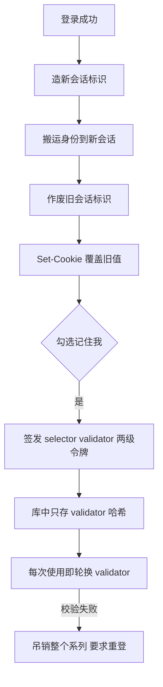

### Q2450 · 记住我的两级令牌:selector 与 validator

> 难度:★★★★ | 标签:Remember-Me, 令牌, 哈希

**问**:"记住我"功能的 Cookie 被拖库或被盗怎么办?selector-validator 两级令牌是怎么设计的?

**答**:两级令牌把凭据拆成两半:selector 用于定位记录(随机但无需保密),validator 是真正的秘密。Cookie 存 "selector:validator",数据库只存 validator 的哈希——拖库者拿到的是哈希,无法伪造可用凭据,这正是密码存储的同款思路搬到会话令牌。校验流程:按 selector 查行,用常数时间比较比对 validator 哈希,合法则立即轮换——生成新 validator、更新库里哈希、下发新 Cookie,每次使用即作废旧的。这套设计的防盗精髓在失败分支:validator 不符说明 Cookie 可能被复制盗用,立即吊销整个系列(该 selector 整行删除),合法用户下次会被踢回登录页并感知到盗用,攻击者与用户不能同时在线。

```python
# file: code/03_Web后端开发/q2450_remember_me_tokens.py
"""记住我的两级令牌: selector-validator 与哈希落库(纯标准库)。"""
import hashlib
import hmac
import secrets


class RememberMeStore:
    """库表只存 selector 与 validator 的哈希, Cookie 存 selector:validator。"""

    def __init__(self):
        self.rows = {}                           # selector -> {"hash", "user", "series"}

    def issue(self, user):
        selector = secrets.token_hex(8)
        validator = secrets.token_urlsafe(32)
        self.rows[selector] = {
            "hash": self._digest(validator),
            "user": user,
            "series": selector,
        }
        return selector + ":" + validator

    def consume(self, cookie_value):
        """校验并轮换: 合法则返回 (用户, 新Cookie), 失败返回 (None, 原因)。"""
        selector, sep, validator = cookie_value.partition(":")
        row = self.rows.get(selector)
        if row is None or not sep:
            return None, "selector 不存在, Cookie 无效"
        if not hmac.compare_digest(row["hash"], self._digest(validator)):
            del self.rows[selector]              # 疑似被盗用: 立即吊销整条系列
            return None, "validator 不符, 已按盗用吊销该系列"
        user = row["user"]
        new_validator = secrets.token_urlsafe(32)
        row["hash"] = self._digest(new_validator)
        return user, selector + ":" + new_validator

    @staticmethod
    def _digest(validator):
        return hashlib.sha256(validator.encode()).hexdigest()


store = RememberMeStore()
cookie1 = store.issue("alice")
print("签发 Cookie:", cookie1[:24] + "...")

user, cookie2 = store.consume(cookie1)
print("首次免登  -> user={} 轮换出新 Cookie".format(user))
assert user == "alice" and cookie2 != cookie1

user2, _ = store.consume(cookie2)
assert user2 == "alice"
print("新 Cookie 可继续使用")

user3, why = store.consume(cookie1)
print("旧 Cookie 重放 -> {} 原因: {}".format(user3, why))
assert user3 is None and "盗用" in why
selector1 = cookie1.partition(":")[0]
assert selector1 not in store.rows, "被盗系列应被吊销"

user4, why4 = store.consume("deadbeef" + ":" + "whatever")
print("伪造 Cookie -> {} 原因: {}".format(user4, why4))
assert user4 is None

# 落库内容核查: 数据库里只有 64 位十六进制哈希, 没有明文 validator
for row in store.rows.values():
    assert len(row["hash"]) == 64 and row["hash"] == row["hash"].lower()
print("要点: selector 定位行避免拿明文查库, validator 只存哈希拖库不泄令牌, "
      "每次使用即轮换, 校验失败立即吊销整个系列以检测 Cookie 被盗")
```

**追问**:
- 为什么不用一个长随机串直接当记住我令牌?——单串方案无法定位记录(只能拿明文查库),也无法实现"使用即轮换"与盗用检测。
- 为什么 selector 可以明文存储?——单有 selector 无法通过校验,它相当于用户名,秘密全在 validator 半边。


