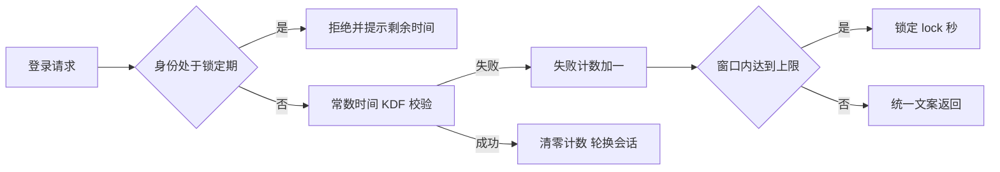

### Q2455 · 登录失败的统一文案与恒定时间

> 难度:★★★☆ | 标签:认证, 时序攻击, 帐号枚举

**问**:为什么登录失败必须返回同一句"用户名或密码错误"?不存在的用户名为什么也要跑一遍哈希?

**答**:差异化响应是帐号枚举的免费情报:回复"用户不存在"与"密码错误"的区别,等于替攻击者维护用户名清单,所以两种失败必须同文案、同状态码、同响应结构。时间维度同样泄露信息:用户不存在时直接返回,比对哈希时逐字节短路,都会让响应时间成为旁路信号,所以无此用户时要用一个预生成的哑哈希把 KDF 烧满一遍,让两种失败的耗时形态一致;哈希比较用 compare_digest,它是常数时间实现,不因前缀匹配而提前返回。这些措施不能让登录变快,反而刻意让它匀速——安全语义优先于微优化。再叠加失败锁定与验证码,枚举成本就抬到不值得攻击的程度。

```python
# file: code/03_Web后端开发/q2455_login_uniform_response.py
"""登录的统一失败语义与恒定时间比较(纯标准库)。"""
import hashlib
import hmac
import time

ITER = 20000
SALT = b"static-demo-salt"
DUMMY = hashlib.pbkdf2_hmac("sha256", b"dummy-password-for-timing", SALT, ITER)
USERS = {"alice": hashlib.pbkdf2_hmac("sha256", b"right-pass", SALT, ITER)}


def attempt(user, pwd):
    """无此用户也跑一遍 KDF 与比较, 让两种失败的耗时形态一致。"""
    stored = USERS.get(user, DUMMY)
    got = hashlib.pbkdf2_hmac("sha256", pwd.encode(), SALT, ITER)
    ok = user in USERS and hmac.compare_digest(got, stored)
    message = "登录成功" if ok else "用户名或密码错误"
    return ok, message


def timing_of(user, pwd, n=5):
    best = None
    for _ in range(n):
        t0 = time.perf_counter()
        attempt(user, pwd)
        dt = time.perf_counter() - t0
        best = dt if best is None else min(best, dt)
    return best


ok1, msg1 = attempt("alice", "right-pass")
ok2, msg2 = attempt("ghost", "whatever")
ok3, msg3 = attempt("alice", "wrong-pass")
print("真实用户+正确密码 -> {} {}".format(ok1, msg1))
print("不存在用户        -> {} {}".format(ok2, msg2))
print("真实用户+错误密码 -> {} {}".format(ok3, msg3))
assert (ok1, ok2, ok3) == (True, False, False)
assert msg2 == msg3, "两种失败必须返回完全相同的文案"

t_ghost = timing_of("ghost", "whatever")
t_wrong = timing_of("alice", "wrong-pass")
print("不存在用户耗时 {:.1f}ms, 密码错误耗时 {:.1f}ms".format(
    t_ghost * 1000, t_wrong * 1000))
assert 0.5 * t_wrong <= t_ghost <= 2.0 * t_wrong, "两种失败的耗时形态应接近"

# 常数时间比较的意义: 逐字节短路比较会在前缀匹配时更快, 泄露匹配进度
assert hmac.compare_digest(b"aaaa", b"aaab") is False
print("要点: 统一文案消除信息差, 不存在用户也烧一次 KDF 拉平耗时, "
      "compare_digest 避免短路比较泄露匹配程度, 三件事共同压缩枚举与侧信道空间")
```

**追问**:
- 注册接口怎么防枚举?——注册页同样返回统一提示并配合验证码或邮件确认,不能明说"该邮箱已注册"。
- 耗时匀速要精确到什么程度?——不必微秒级一致,只要同量级且与"用户是否存在"不相关即可,网络抖动会掩盖残余差异。


