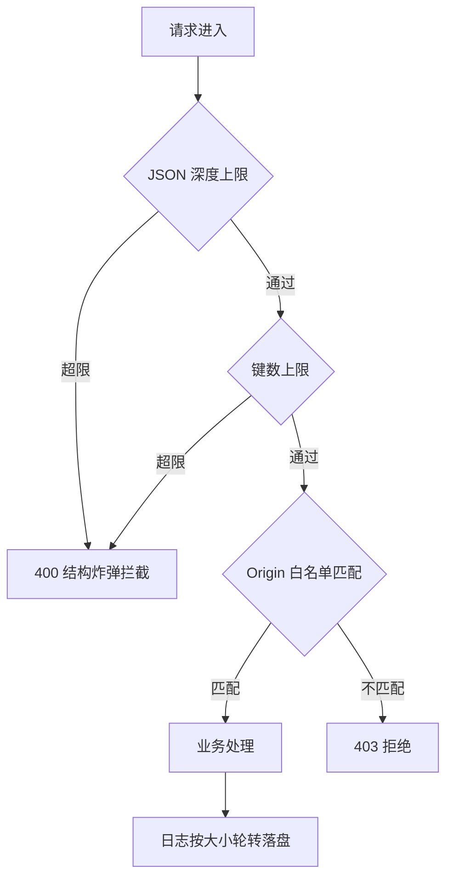

### Q2460 · JSON 请求体的深度与键数防御

> 难度:★★★☆ | 标签:JSON, 拒绝服务, 输入防护

**问**:请求体大小限制了还不够吗?JSON 深度炸弹与键数炸弹分别怎么防?

**答**:大小限制挡不住结构炸弹:几 KB 的报文可以嵌套千层(深度炸弹打递归栈)或塞百万个键(键数炸弹打哈希表内存与 CPU)。防御在解析过程中做:利用 object_pairs_hook 在每个对象构造时触发,累计键数超限即抛错中止——钩子在解析途中执行,不给深层结构展开的机会;深度则解析后扫描容器层级计数,只对 dict 与 list 计层,标量不占深度。两个补充防线:入口处仍要限制请求体大小与解析超时,因为极深输入可能先触发解释器自身的 RecursionError,结构检查来不及介入;重复键可在钩子里显式检测,last-wins 的默认行为会静默吞掉语义冲突。这套思路同样适用于 XML(XXE 与深度)与 YAML 反序列化的防护。

```python
# file: code/03_Web后端开发/q2460_json_body_guard.py
"""JSON 请求体的深度与键数防御(纯标准库)。"""
import json


class BodyLimitError(ValueError):
    """请求体结构超限。"""


def guarded_loads(text, max_depth=8, max_keys=64):
    stats = {"depth": 0, "keys": 0}

    def pairs_hook(pairs):
        """解析过程中逐对象触发, 超限即中止, 不给深结构机会展开。"""
        stats["keys"] += len(pairs)
        if stats["keys"] > max_keys:
            raise BodyLimitError("键总数超过上限 {}".format(max_keys))
        return dict(pairs)

    def scan_depth(obj, level=1):
        """只对容器计层, 标量不占深度。"""
        if isinstance(obj, (dict, list)):
            if level > stats["depth"]:
                stats["depth"] = level
            if level > max_depth:
                raise BodyLimitError("嵌套深度超过上限 {}".format(max_depth))
            for value in (obj.values() if isinstance(obj, dict) else obj):
                scan_depth(value, level + 1)

    obj = json.loads(text, object_pairs_hook=pairs_hook)
    scan_depth(obj)
    return obj, stats


# 正常请求
obj, stats = guarded_loads('{"user": {"name": "li", "tags": ["a", "b"]}}')
print("正常请求 -> 深度 {} 键数 {}".format(stats["depth"], stats["keys"]))
assert stats["depth"] == 3 and stats["keys"] == 3

# 深度炸弹: 12 层嵌套, 超过 8 层上限
deep = '{"a": ' * 12 + "1" + "}" * 12
try:
    guarded_loads(deep, max_depth=8)
    raise AssertionError("深度炸弹必须被拦截")
except BodyLimitError as exc:
    print("深度炸弹 -> 拦截: {}".format(exc))

# 键数炸弹: 100 个键
many = "{" + ",".join('"k{}": 1'.format(i) for i in range(100)) + "}"
try:
    guarded_loads(many, max_keys=64)
    raise AssertionError("键数炸弹必须被拦截")
except BodyLimitError as exc:
    print("键数炸弹 -> 拦截: {}".format(exc))

# object_pairs_hook 还顺带保留重复键的侦测能力
try:
    guarded_loads('{"a": 1, "a": 2}')
except BodyLimitError:
    raise AssertionError("不应误伤")
print("重复键场景 -> 正常解析, dict 后键覆盖前键, 如需拒绝重复键可在 hook 里检测")
print("要点: 大小限制挡不住结构炸弹, 深度防递归打栈, 键数防哈希碰撞与内存膨胀, "
      "钩子在解析途中触发可以尽早失败")
```

**追问**:
- 为什么不用 try/except RecursionError 兜底?——可以但要设解释器递归上限,显式深度检查能在更早、更明确的层面拒绝,错误信息也更友好。
- 深度上限取多少合适?——常规业务数据五到十层足够,按接口真实结构留余量,超出即视为异常输入。


