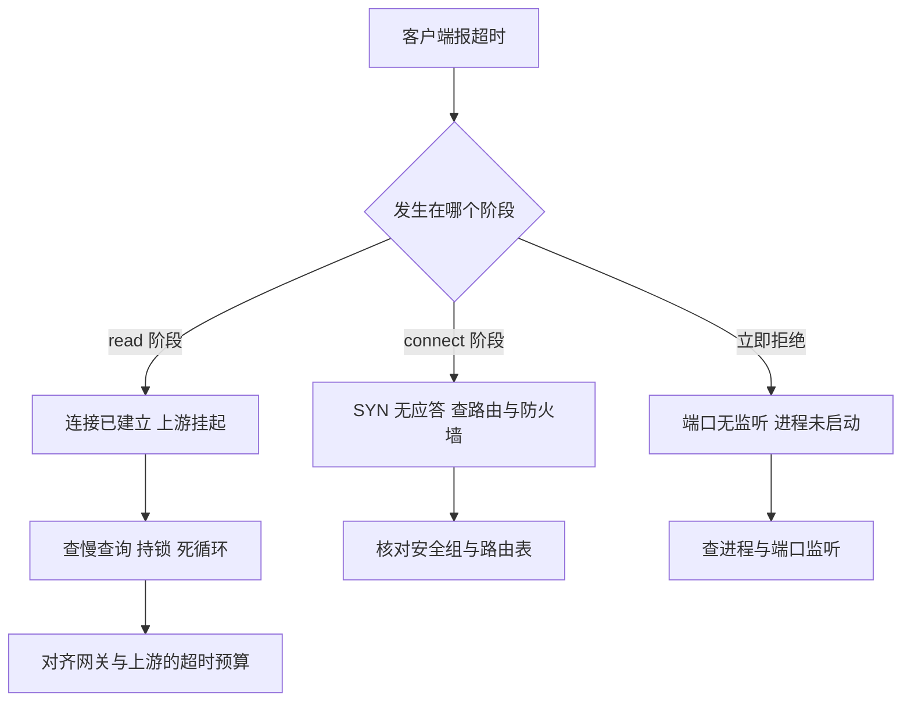

### Q2465 · 连接超时与读超时的定位实验

> 难度:★★★★ | 标签:排障, socket, 超时

**问**:客户端报超时,怎么用实验区分是连接阶段还是读阶段的问题?

**答**:三个回环实验对应三种病:端口无监听,内核立即回 RST,得到的是 ConnectionRefused 而不是超时——立即失败说明请求根本没进对端应用;连接阶段超时,SYN 发出去石沉大海(防火墙 DROP 或路由黑洞),卡在 connect 直到超时;读阶段超时,连接建立成功但对端 accept 后不吐数据,recv 等 settimeout 的时长后抛 socket.timeout——这指向应用挂起:慢查询、持锁、死循环。定位口诀按现象反查:立即拒绝查进程与端口,connect 超时查网络链路与安全组,read 超时查上游应用与网关超时预算的匹配(网关超时要大于上游 P99,小于客户端容忍)。socket 的 settimeout 同时管 connect 与 recv,要分层计时得分别设置或用非阻塞加选择器。

```python
# file: code/03_Web后端开发/q2465_timeout_location.py
"""连接超时与读超时的定位实验: 回环 socket 三场景(纯标准库)。"""
import socket
import threading
import time


def read_timeout_demo():
    """对端 accept 后装死: 连接建立成功但 recv 等不到数据 -> 读超时。"""
    srv = socket.socket()
    srv.bind(("127.0.0.1", 0))
    srv.listen(1)
    port = srv.getsockname()[1]
    conns = []

    def server():
        conn, _ = srv.accept()
        conns.append(conn)                       # 收下连接但永不响应
    worker = threading.Thread(target=server, daemon=True)
    worker.start()

    cli = socket.socket()
    cli.settimeout(0.5)
    cli.connect(("127.0.0.1", port))
    t0 = time.perf_counter()
    try:
        cli.recv(1024)
        outcome, kind = "意外收到数据", "ok"
    except socket.timeout:
        outcome, kind = "读超时: 连接已建立但对端不吐数据", "read-timeout"
    elapsed = time.perf_counter() - t0
    cli.close()
    if conns:
        conns[0].close()
    srv.close()
    worker.join(1)
    return kind, outcome, elapsed


def connect_refused_demo():
    """端口没有监听: 内核立即回 RST -> 快速失败而不是超时。"""
    probe = socket.socket()
    probe.bind(("127.0.0.1", 0))
    dead_port = probe.getsockname()[1]
    probe.close()
    cli = socket.socket()
    cli.settimeout(0.5)
    try:
        cli.connect(("127.0.0.1", dead_port))
        cli.close()
        return "意外连通"
    except ConnectionRefusedError:
        return "连接拒绝: 端口无监听, 立即失败而非超时"
    except socket.timeout:
        return "连接超时"


def connect_timeout_demo():
    """不可路由地址: SYN 无应答 -> 超时发生在 connect 阶段。"""
    cli = socket.socket()
    cli.settimeout(0.5)
    try:
        cli.connect(("10.255.255.1", 81))        # 演示用私网黑洞地址
        cli.close()
        return "意外连通"
    except socket.timeout:
        return "连接超时: SYN 无应答, 卡在 connect 阶段"
    except OSError as exc:
        return "网络不可达快速失败: {}".format(exc)


kind, outcome, elapsed = read_timeout_demo()
print("场景一 {:6s} 耗时 {:.2f}s -> {}".format(kind, elapsed, outcome))
assert kind == "read-timeout"
assert 0.4 <= elapsed <= 2.0, "读超时应在 settimeout 附近触发"

print("场景二 ->", connect_refused_demo())
print("场景三 ->", connect_timeout_demo())

print("定位口诀:")
print("  立即 ConnectionRefused -> 端口没监听, 进程挂了或没启动")
print("  卡在 connect 后超时   -> 网络丢包或防火墙 DROP, 查路由与安全组")
print("  连接成功后读超时      -> 上游挂起, 查慢查询 持锁 与死循环")
print("  网关报 502 或 504     -> 对照上游日志确认是拒绝服务还是等超时")
print("要点: 两类超时是两种病, connect 超时指向网络链路, read 超时指向应用挂起; "
      "连接拒绝不超时, 说明请求根本没到达对端应用")
```

**追问**:
- 为什么连接拒绝不是一种超时?——RST 是内核的即时应答,连接根本没建立,它与"无应答"是两类网络事件,排障方向完全不同。
- 生产上怎么持续观测这两类超时的比例?——客户端 SDK 分类计数 connect timeout、read timeout、refused 三个指标,比例突变即是链路或上游健康的风向标。


