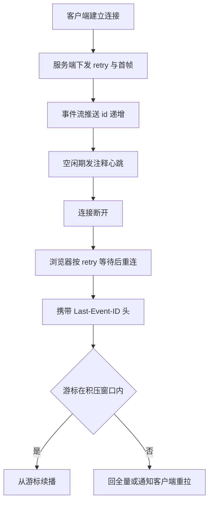

### Q2706 · SSE 的注释心跳与代理缓冲穿透

> 难度:★★★☆ | 标签:SSE, 反向代理, 长连接

**问**:SSE 部署到 Nginx 后面,事件总是成簇到达,是怎么回事?

**答**:中间某层在做响应缓冲:事件攒到缓冲区满或连接结束才一次性下发。解法是穿透三件套:响应头 `Cache-Control: no-cache` 禁缓存、`X-Accel-Buffering: no` 明确告诉 Nginx 别缓冲、`Connection: keep-alive` 保持长连;再加注释心跳——空闲时定期发 `: ping` 这样的注释帧,以冒号开头的行浏览器不派发任何事件,但能定期冲刷链路缓冲、让代理判定连接存活。心跳间隔必须小于链路上最短的读超时,一般 15 秒量级;事件流开头可先垫一段注释把代理的初始缓冲顶出去。任何一层缓冲都会让实时推送退化为批处理,穿透配置要跟着部署拓扑走。

```python
# file: code/03_Web后端开发/q2706_sse_heartbeat.py
"""SSE 的注释心跳与代理穿透: 让长连接穿过会缓冲的中间层(纯标准库)。"""


def sse_event(data, event_id=None):
    lines = []
    if event_id is not None:
        lines.append("id: %s" % event_id)
    lines.append("data: %s" % data)
    return "\n".join(lines) + "\n\n"


def sse_headers():
    """穿透三件套: 禁缓存, 告诉 Nginx 别缓冲, 明确保活。

    任何一层缓冲都会让事件攒到缓冲区满才下去, 客户端表现为延迟成簇到达。
    """
    return {
        "Content-Type": "text/event-stream",
        "Cache-Control": "no-cache",
        "X-Accel-Buffering": "no",
        "Connection": "keep-alive",
    }


class HeartbeatSse:
    """空闲超interval就发注释行 ': ping', 注释帧不会触发客户端 message 事件。"""

    def __init__(self, interval=15.0):
        self.interval = interval
        self.last_sent = 0.0
        self.seq = 0

    def on_event(self, now, data):
        self.last_sent = now
        self.seq += 1
        return sse_event(data, event_id=str(self.seq))

    def on_tick(self, now):
        """返回注释帧或 None: 由事件循环每秒调一次。"""
        if now - self.last_sent >= self.interval:
            self.last_sent = now
            return ": ping %d\n\n" % int(now)
        return None


stream = HeartbeatSse(interval=15.0)
out = [stream.on_event(0.0, "hello")]
for t in (5.0, 14.0, 15.0, 20.0, 35.0):
    frame = stream.on_tick(t)
    if frame:
        out.append(frame)
assert out[0] == "id: 1\ndata: hello\n\n"
assert out[1].startswith(": ping"), out[1]
assert out[1].count("data:") == 0, "注释帧不携带 data, 客户端不派发事件"
print("心跳帧序列:", [f.splitlines()[0] for f in out[1:]])
print("响应头:", sse_headers())
```

**追问**:
- 注释心跳会不会触发客户端回调?——不会,注释帧不构成 message 事件,浏览器层面完全无感,只耗极小带宽。
- 客户端代理(企业网关)也缓冲怎么办?——注释帧垫大初始缓冲加心跳是通用手段,再不行只能降级到轮询,那是链路能力问题。


