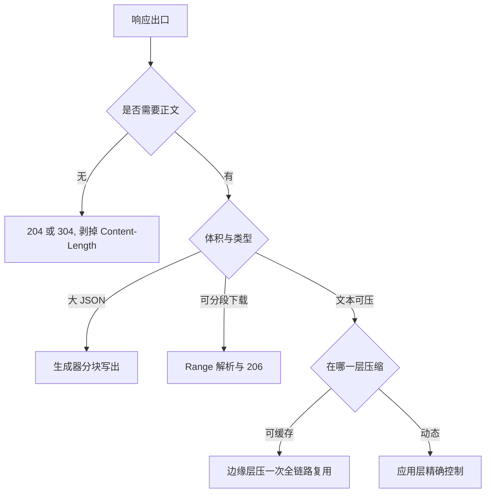

### Q2712 · 204 与空响应体的正确形态

> 难度:★★☆☆ | 标签:HTTP 协议, 状态码

**问**:DELETE 成功了该返回什么?为什么很多接口返回 200 加一个 success true?

**答**:204 No Content 是首选:语义明确"成功且无正文",客户端无 body 可读,服务端省一次序列化。形态契约三条:204 不得携带任何正文,且 MUST NOT 带 Content-Length(RFC 9110),Transfer-Encoding 同理——很多框架默认给空响应补 Content-Length: 0,要记得剥掉;304 同样无正文,但 Content-Length 允许,而 ETag 这类条件字段必须回传,否则客户端缓存协商失效;205 的语义是让客户端重置表单,不是 204 的同义词。200 包 success 的写法把"成功"变成需要解析的约定,通用客户端与缓存都无法识别,是 REST 语义的退步。DELETE/PUT 成功回 204,创建回 201,读取回 200,这套语义稳定后客户端代码也简单。

```python
# file: code/03_Web后端开发/q2712_empty_body_204.py
"""204 与空响应体的正确形态: 没有正文就不能再带 Content-Length(纯标准库)。"""


def check_empty_response(status, headers, body=b""):
    """校验空体响应的形态契约, 返回违规列表。

    204 不得有正文, 且 MUST NOT 带 Content-Length(RFC 9110 8.6)与 Transfer-Encoding;
    304 不得有正文, 但 Content-Length 允许, 而 ETag 这类条件字段必须回传;
    205 同样无正文; 205 的语义是让客户端重置表单, 不是 204 的同义词。
    """
    bad = []
    if status == 204:
        if body:
            bad.append("204 携带了正文")
        if "Content-Length" in headers:
            bad.append("204 不应带 Content-Length")
        if "Transfer-Encoding" in headers:
            bad.append("204 不应带 Transfer-Encoding")
    elif status == 304:
        if body:
            bad.append("304 携带了正文")
        if "ETag" not in headers:
            bad.append("304 应回传条件请求用到的 ETag")
    if status == 205 and body:
        bad.append("205 同样不应有正文")
    return bad


CASES = [
    (204, {}, b""),
    (204, {"Content-Length": "0"}, b""),
    (204, {"Content-Type": "application/json"}, b"null"),
    (304, {"ETag": '"v1"'}, b""),
    (304, {}, b""),
    (205, {"Content-Length": "0"}, b""),
]
for status, headers, body in CASES:
    issues = check_empty_response(status, headers, body)
    print("%d %-30s -> %s" % (status, headers or "空头", issues or "合规"))

assert check_empty_response(204, {}, b"") == []
assert check_empty_response(204, {"Content-Length": "0"}, b"") == ["204 不应带 Content-Length"]
assert check_empty_response(204, {"Content-Type": "application/json"}, b"null") == ["204 携带了正文"]
assert check_empty_response(304, {"ETag": '"v1"'}, b"") == []
assert check_empty_response(304, {}, b"") == ["304 应回传条件请求用到的 ETag"]
# DELETE/PUT 成功回 204: 成功语义明确, 无正文可读, 也省一次序列化
print("经验: 204 是 DELETE/PUT 的首选成功码, 框架默认加 Content-Length 时要记得剥掉")
```

**追问**:
- 204 带 Content-Type 算违规吗?——不算,头字段可以描述未来 GET 会返回的内容;违规的只有正文与 Content-Length。
- HEAD 请求的响应呢?——无正文但头与 GET 一致,Content-Length 表示假想正文长度,这是合法且必要的。


