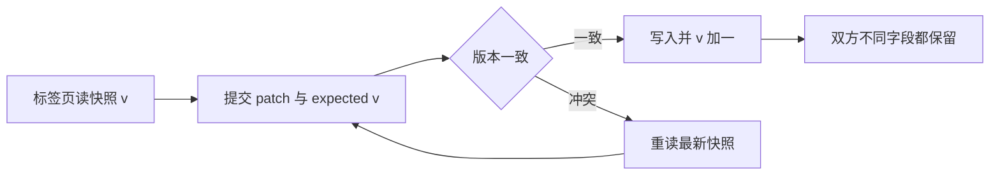

### Q2717 · 多标签页的会话写竞争与 CAS 合并

> 难度:★★★★ | 标签:会话, 并发控制, CAS

**问**:用户开两个标签页改购物车,一个加 B 一个加 D,结果 B 丢了,怎么修?

**答**:这是读-改-写覆盖丢失:两个标签页都基于同一份快照修改,后写者整值覆盖,先写者的字段无痕消失。两层修复:写入带版本号做 CAS——提交时携带读到的 expected version,不匹配就拒绝并重读重放,不同字段的改动都能存活;patch 只带自己改过的字段,不要把整份快照回传。残余问题要承认:CAS 合并解决字段间竞争,同一字段内的列表并发仍需增量语义(add/remove 操作而非整值替换),数量类字段用旧值加增量;重试要有上限,超限回给客户端"页面已过期请刷新"。服务端可以再加每会话写序列化,把竞争收口到单点,但那要求会话操作有明确的入口层。

```python
# file: code/03_Web后端开发/q2717_tab_race_merge.py
"""多标签页的会话写竞争: 覆盖丢失与版本化合并(纯标准库)。"""


class VersionedStore:
    """每个键带版本号, 写入必须携带读到的版本, 不匹配即拒绝(CAS)。"""

    def __init__(self):
        self.data = {}
        self.version = {}

    def read(self, key):
        return dict(self.data.get(key, {})), self.version.get(key, 0)

    def write(self, key, value, expected):
        if self.version.get(key, 0) != expected:
            return False
        self.data[key] = dict(value)
        self.version[key] = expected + 1
        return True


def lww_write(store, key, value):
    """裸覆盖: 谁后写谁赢, 早写的改动无痕丢失。"""
    store.data[key] = dict(value)
    store.version[key] = store.version.get(key, 0) + 1


def merge_write(store, key, patch, racer=None, max_retry=3):
    """读-合-写 CAS 循环: 失败就重读重放; patch 只放自己改过的字段。

    racer 参数模拟并发对手在读取与写入之间抢跑, 仅供演示竞争路径。
    """
    data, v = store.read(key)
    for attempt in range(1, max_retry + 1):
        if racer:
            racer(data, v)
        merged = dict(data)
        merged.update(patch)
        if store.write(key, merged, v):
            return True, attempt
        data, v = store.read(key)
    return False, max_retry


store = VersionedStore()
base = {"cart": ["A"], "coupon": None}
store.data["sess1"] = dict(base)

# 裸覆盖: 标签页 A 加了 B, 标签页 C 拿着旧快照加 D, B 被吃掉
lww_write(store, "sess1", {"cart": ["A", "B"], "coupon": None})
lww_write(store, "sess1", {"cart": ["A", "D"], "coupon": None})
assert store.data["sess1"]["cart"] == ["A", "D"], "裸覆盖丢失了标签页 A 的 B"

# CAS: C 读取与写入之间, 标签页 A 抢先改了 coupon, C 首写撞版本, 重读合并后双方都保留
store2 = VersionedStore()
store2.data["sess1"] = dict(base)
raced = {"done": False}


def racer(data, v):
    if not raced["done"]:
        raced["done"] = True
        assert store2.write("sess1", dict(data, coupon="VIP"), v), "标签页 A 抢先写 coupon"


ok, tries = merge_write(store2, "sess1", {"cart": ["A", "D"]}, racer=racer)
assert ok and tries == 2, (ok, tries)
final = store2.data["sess1"]
assert final == {"cart": ["A", "D"], "coupon": "VIP"}, final
print("裸覆盖结果:", store.data["sess1"]["cart"], "(同字段整值替换仍需增量语义)")
print("CAS 合并结果:", final, "重试 %d 次" % tries)
```

**追问**:
- 为什么不干脆每次写都广播同步各标签页?——可以但要引入广播通道(WebStorage 事件或 WebSocket),成本在客户端一致性维护;CAS 是无通道前提下的最低保障。
- 版本号放在会话级还是字段级?——会话级实现简单但竞争率高,写频繁的会话升到字段级,按竞争热度分层。


