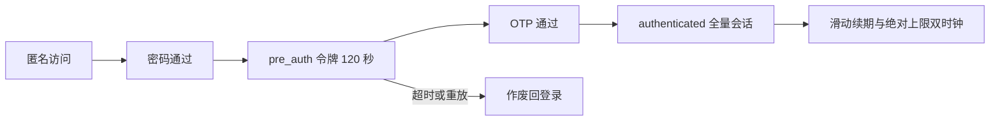

### Q2723 · 两步登录的中间态会话

> 难度:★★★☆ | 标签:认证, MFA, 状态机

**问**:密码过了但 OTP 还没验,这个中间态怎么建模才安全?

**答**:状态机建模:anonymous 到 pre_auth 再到 authenticated。密码通过后签发 pre_auth 令牌,三重限制钉死:scope 固定为 login-continue,业务接口的会话检查在 scope 上直接拒绝;TTL 很短(2 分钟);一次性——升级成功的 jti 用后即焚,重放拒绝。OTP 验证把 pre_auth 升级为全量会话并作废中间态,超时不验自动作废。细节:同参数两次签发必须加 nonce 区分,否则两次签名相同,升级一张就废掉另一张;pre_auth 令牌泄露的爆炸半径被限制在"能完成一次登录",远小于可访问业务的会话。中间态也要限速,OTP 尝试次数挂在 pre_auth 令牌上,超限作废重来。

```python
# file: code/03_Web后端开发/q2723_two_step_login.py
"""两步登录的中间态会话: pre-auth 令牌单用途升级(纯标准库)。"""
import hashlib
import hmac
import json

SECRET = b"two-step-key"


def sign(payload):
    raw = json.dumps(payload, sort_keys=True, separators=(",", ":")).encode("utf-8")
    return hmac.new(SECRET, raw, hashlib.sha256).hexdigest()[:16]


class LoginFlow:
    """状态机: anonymous -> pre_auth(密码通过) -> authenticated(OTP 通过)。

    pre_auth 令牌: scope 钉死为 login-continue, TTL 很短, 一次性, 不能访问业务。
    """

    def __init__(self, now=lambda: 0.0, pre_ttl=120.0):
        self._now = now
        self.pre_ttl = pre_ttl
        self.pending = {}   # jti -> {"sub": user, "exp": ...}
        self.used = set()   # 已升级的 jti, 防重放
        self.sessions = {}
        self._nonce = 0

    def password_ok(self, user):
        # 同参数两次签发必须可区分: 不加 nonce, 两次签名相同, 升级一张就废掉另一张
        self._nonce += 1
        payload = {"sub": user, "scope": "login-continue",
                   "exp": self._now() + self.pre_ttl, "n": self._nonce}
        jti = sign(payload)
        self.pending[jti] = payload
        return jti

    def otp_ok(self, jti):
        if jti in self.used:
            return "replayed"
        p = self.pending.get(jti)
        if p is None or p["exp"] <= self._now():
            return "invalid_or_expired"
        self.used.add(jti)
        del self.pending[jti]
        self.sessions[p["sub"]] = {"scope": "authenticated"}
        return "authenticated"

    def business_access(self, jti):
        """pre_auth 令牌不许碰业务接口: scope 检查在会话判定之前。"""
        p = self.pending.get(jti)
        return "denied_pre_auth" if p else "no_session"


clock = {"t": 0.0}
flow = LoginFlow(now=lambda: clock["t"])
jti = flow.password_ok("u1")
assert flow.business_access(jti) == "denied_pre_auth", "中间态令牌不能访问业务"
assert flow.otp_ok(jti) == "authenticated"
assert flow.otp_ok(jti) == "replayed", "升级成功的 jti 不允许二次使用"
jti2 = flow.password_ok("u1")
clock["t"] = 121.0
assert flow.otp_ok(jti2) == "invalid_or_expired", "中间态 2 分钟不过就作废"
print("流程: 密码通过发 pre_auth(120s, 单用途) -> OTP 升级 -> jti 用后即焚")
print("拒绝矩阵: 业务访问 denied, 重放 replayed, 超时 invalid_or_expired")
```

**追问**:
- OTP 次数限制挂在哪个状态上?——挂在 pre_auth 令牌上,每个令牌限 N 次,超限作废,锁定的是登录流程而非全局账号。
- 中间态能跳过 OTP 直接给全量会话吗?——不能,pre_auth 的 scope 就是干这个的;任何放行路径都从 scope 检查过,没有旁路。


