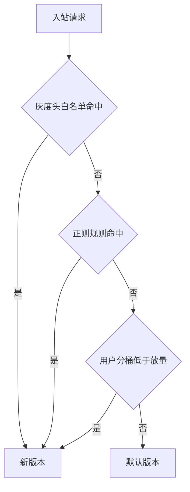

### Q2728 · 灰度路由的头匹配引擎

> 难度:★★★★ | 标签:灰度发布, 路由, FastAPI

**问**:新版本想先放 20% 用户,再对 beta 用户全量,路由规则怎么实现?

**答**:头匹配引擎三层:白名单(in 匹配 X-Gray-User)保内部账号先行、正则匹配区域标记、稳定百分比放量——对用户标识做带盐哈希取桶,桶号低于放量比例即命中,同一用户每次落到同一桶,放量比例只增不减时用户不会被来回切换。评估顺序固定:白名单、正则、百分比、默认版本,命中即走。实现落点:网关或中间件按头路由,并把命中版本回显进响应头(X-Backend),观测与回滚都有依据;盐值换版等于重新洗牌,放量期间禁止换盐。无灰度头的请求稳定走默认,天然兼容老客户端;千名用户的分桶分布要实测近似均匀,偏斜说明哈希选错。

```python
# file: code/03_Web后端开发/q2728_gray_header_route.py
"""灰度路由的头匹配引擎: 白名单、正则与稳定百分比(缺库降级)。"""
import hashlib
import re
import sys

try:
    from fastapi import FastAPI, Request
    from fastapi.testclient import TestClient
    HAS_FASTAPI = True
except ImportError:
    HAS_FASTAPI = False
    print("未安装 fastapi/httpx, 框架部分跳过, 标准库演示匹配引擎")


def bucket(salt, value, percent_base=100):
    """稳定分桶: 同一用户每次哈希到同一桶, 放量比例只增不减时用户不会被来回切换。"""
    digest = hashlib.md5((salt + "|" + value).encode("utf-8")).hexdigest()
    return int(digest, 16) % percent_base


def match_rule(rule, headers):
    value = None
    for k, v in headers.items():
        if k.lower() == rule["header"].lower():
            value = v
            break
    if value is None:
        return False
    kind = rule["matcher"]
    if kind == "in":
        return value in rule["values"]
    if kind == "regex":
        return re.search(rule["pattern"], value) is not None
    if kind == "percent":
        return bucket(rule["salt"], value) < rule["percent"]
    return False


def route(headers, rules, default="v1"):
    for r in rules:
        if match_rule(r, headers):
            return r["backend"]
    return default


RULES = [
    {"header": "X-Gray-User", "matcher": "in", "values": ["u1", "u7"], "backend": "v2"},
    {"header": "X-Region", "matcher": "regex", "pattern": "^beta-", "backend": "v2"},
    {"header": "X-User", "matcher": "percent", "percent": 50, "salt": "2026Q4", "backend": "v2"},
]
assert route({}, RULES) == "v1", "无头走默认版本"
assert route({"X-Gray-User": "u7"}, RULES) == "v2", "白名单优先"
assert route({"X-Region": "beta-sh-1"}, RULES) == "v2"
assert route({"X-Region": "prod-sh-1"}, RULES) == "v1", "正则未中落到百分比规则, 头不在则默认版本"
u100 = bucket("2026Q4", "u100")
assert route({"X-User": "u100"}, RULES) == ("v2" if u100 < 50 else "v1")
assert all(route({"X-User": "u100"}, RULES) == route({"X-User": "u100"}, RULES) for _ in range(5))
in_v2 = sum(bucket("2026Q4", "u%d" % i) < 50 for i in range(1000))
assert 450 <= in_v2 <= 550, "分桶应近似均匀: %d" % in_v2
print("分桶 u100=%d, 千名用户命中 v2 的 %d 个, 白名单 > 正则 > 百分比" % (u100, in_v2))

if HAS_FASTAPI:
    app = FastAPI()

    @app.middleware("http")
    async def gray(request: Request, call_next):
        backend = route(dict(request.headers), RULES)
        response = await call_next(request)
        response.headers["X-Backend"] = backend
        return response

    @app.get("/api")
    async def api():
        return {"ok": True}

    client = TestClient(app)
    assert client.get("/api").headers["X-Backend"] == "v1"
    assert client.get("/api", headers={"X-Gray-User": "u1"}).headers["X-Backend"] == "v2"
    print("中间件按头路由, X-Backend 回显命中版本")
```

**追问**:
- 为什么用哈希分桶而不是随机数?——随机数同一用户时中时不中,体验分裂且回滚无法判定;哈希分桶给每个用户一个稳定身份刻度。
- 灰度规则越来越长,怎么治理?——规则引擎化加过期时间,每条规则带生效窗口与负责人,过期自动失效,防止规则列表变成考古现场。


