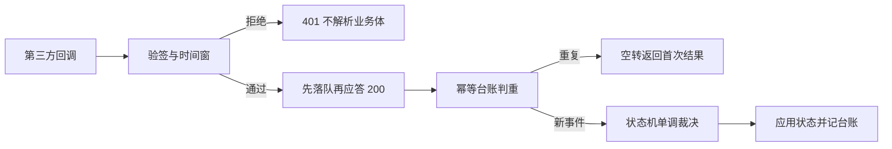

### Q2734 · 大整数的 JS 安全范围

> 难度:★★☆☆ | 标签:JSON, 数据类型, 兼容性

**问**:雪花 ID 传给前端后订单对不上号,这是什么问题?

**答**:JS 的 Number 是 IEEE 754 双精度,尾数只有 53 位,超过 2^53-1(9007199254740991)的整数在 JSON.parse 时静默丢精度——雪花 ID 十九位,末位直接变 0,前端拿它回查当然对不上。约定三条:出接口超过安全范围的整数自动转字符串,递归变换要在 json.dumps 之前做——注意 json.dumps 的 default 钩子对 int 不会触发,int 本身可序列化,这是最容易踩的实现坑;入接口宽松收,字符串与整数都认,校验后统一转 int 存库;布尔要先于整数判断(bool 是 int 子类,递归变换别把 true 变成串)。双向约定写进接口文档:出转串,入两者都收,后端永远存 int。

```python
# file: code/03_Web后端开发/q2734_bigint_safe_range.py
"""大整数的 JS 安全范围: 超过 2^53-1 就按字符串走(纯标准库)。"""
import json

MAX_SAFE = 2 ** 53 - 1  # JS Number.MAX_SAFE_INTEGER


def js_safe(value):
    """出接口的整数出口: |v| 超过安全范围就转字符串, 调用方无需感知。

    注意 json.dumps 的 default 钩子不会对 int 触发(int 本身可序列化),
    所以必须先递归变换再 dumps, 这是最容易踩的实现坑。
    """
    if isinstance(value, bool):
        return value
    if isinstance(value, int):
        return str(value) if abs(value) > MAX_SAFE else value
    if isinstance(value, dict):
        return {k: js_safe(v) for k, v in value.items()}
    if isinstance(value, list):
        return [js_safe(x) for x in value]
    return value


def dump(obj):
    return json.dumps(js_safe(obj), ensure_ascii=False)


def accept_id(raw):
    """入接口宽松收: 字符串与整数都认, 校验后统一成 int 存库。"""
    if isinstance(raw, int):
        return raw
    if isinstance(raw, str) and raw.isdigit():
        return int(raw)
    raise ValueError("非法 id")


snowflake = 7266410535277015041  # 典型雪花 ID, 远超 2^53-1
payload = {"id": snowflake, "count": 42, "parent": -snowflake}
text = dump(payload)
assert '"id": "7266410535277015041"' in text and '"count": 42' in text
parsed = json.loads(text)
assert isinstance(parsed["id"], str)
assert accept_id(parsed["id"]) == snowflake and accept_id(42) == 42
try:
    accept_id("12x")
except ValueError as e:
    print("非法 id 拒收:", e)

as_double = int(float(snowflake))  # JS Number 是 IEEE 754 双精度, 尾数只有 53 位
assert as_double != snowflake, "JS 端 JSON.parse 会静默丢精度"
print("Python 往返无损, 但 JS 拿到 Number 会变成 %d, 字符串传输才无损" % as_double)
print("安全范围 %d; 超限自动转字符串, 双向约定: 出转串, 入两者都收" % MAX_SAFE)
```

**追问**:
- 为什么不用 BigInt 解决?——JSON 标准没有 BigInt 类型,JSON.parse 的 Number 语义改不了;字符串是唯一跨语言无损方案,JSON.parse 支持 reviver 也只是补丁。
- 小整数要不要也转字符串?——不要,安全范围内 Number 精确;全部转串会教坏客户端对类型的预期,按阈值分流即可。


