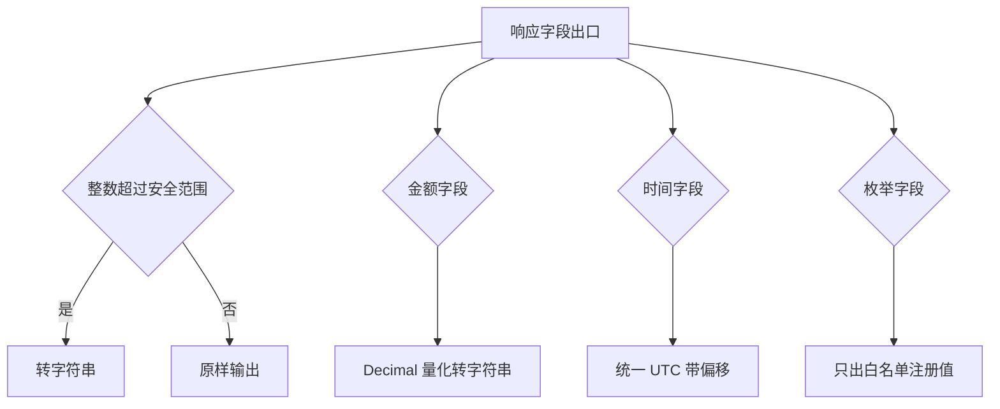

### Q2740 · Base64 与二进制字段的传输选择

> 难度:★★☆☆ | 标签:二进制, Base64, 接口设计

**问**:接口里要带一张小图标和一个 PDF,二进制字段该内联还是给链接?

**答**:三个维度定去向:大小、可缓存性、类型。base64 内联有恒定约三分之一的体积膨胀,塞进 JSON 还要拖累解析与缓存,所以只适合小体量:小图标内联成 data URL,合并请求数;可缓存的大媒体给稳定 URL,让 CDN 与浏览器强缓存接管,主响应保持苗条;不可缓存的大文件走独立下载接口按需取。实现上 data URL 的编解码要保留 Content-Type 信息(`data:image/png;base64,`),往返测试验证字节一致与类型还原;阈值 4KB 量级是经验值,过线就切引用。判断口诀:高频重复用的小资源内联,大而可缓存的给 URL,其余按需取——内联是便利性,引用是缓存效率,按资源生命周期选。

```python
# file: code/03_Web后端开发/q2740_binary_field.py
"""Base64 与二进制字段的传输选择: 内联还是引用(纯标准库)。"""
import base64

INLINE_LIMIT = 4096  # 超过 4KB 就别塞 JSON 了


def choose_transport(size, cacheable, content_type):
    """三个维度定去向: 大小、可缓存性、类型。

    - 小图标且要缓存 -> data URL 内联, 省一次请求;
    - 大文件或可缓存媒体 -> 独立 URL, 让 CDN 与浏览器缓存接管;
    - 中等大小动态内容 -> 引用接口按需取, 主响应保持苗条。
    """
    if content_type.startswith("image/") and size <= INLINE_LIMIT:
        return "inline", "小图标内联进 data URL, 合并请求数"
    if cacheable and size > INLINE_LIMIT:
        return "url", "可缓存媒体给稳定 URL, 交给 CDN 与强缓存"
    if size > INLINE_LIMIT:
        return "endpoint", "大体积单独走下载接口, 主响应不膨胀"
    return "inline", "小体量直接内联, 一次拿全"


def to_data_url(raw, content_type):
    return "data:%s;base64,%s" % (content_type, base64.b64encode(raw).decode("ascii"))


def from_data_url(text):
    head, _, b64 = text.partition(",")
    return base64.b64decode(b64), head[5:].split(";")[0]


raw = bytes(range(256)) * 8  # 2048 字节
url = to_data_url(raw, "image/png")
payload, ctype = from_data_url(url)
assert payload == raw and ctype == "image/png"
overhead = len(url) / len(raw) - 1
assert 0.30 < overhead < 0.40, "base64 膨胀率恒定约 33%%: %.1f%%" % (overhead * 100)

for size, cacheable, ct, want in [
    (1024, False, "image/png", "inline"),
    (10 * 1024 * 1024, True, "image/jpeg", "url"),
    (100 * 1024, False, "application/pdf", "endpoint"),
    (128, False, "application/json", "inline"),
]:
    got, why = choose_transport(size, cacheable, ct)
    assert got == want, (size, ct, got, want)
    print("%10dB %-18s -> %-8s %s" % (size, ct, got, why))
print("base64 膨胀 %.1f%%: 大文件内联是带宽放大器, 引用 URL 才能吃到缓存" % (overhead * 100))
```

**追问**:
- base64 膨胀为什么是三分之一而不是四分之一?——3 字节编 4 字符,膨胀 4/3 减 1 约 33%,还有 data URL 头与填充字符的零头。
- HTTP/2 下还有必要内联小图标吗?——连接复用降低了合并请求的收益,内联主要剩缓存劣势;小 SVG 直接内联文本或用雪碧图,base64 内联要重新评估。


