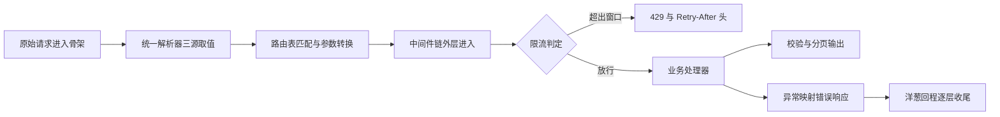

### Q2922 · 请求限流的内存完整实现: 滑动窗口与自动清理

> 难度:★★★☆ | 标签:限流, 并发

**问**:给我一个不依赖 Redis 的单机限流完整方案: 数据结构、过期清理、并发安全和响应头都要考虑。

**答**:数据结构是每 key 一个时间戳列表, 判定时裁掉窗外旧样本再数个数, 这是滑动窗口日志, 精确无边界突发; 时钟做成可注入的 callable, 测试时手动推进就能复现窗口行为。并发安全靠一把 Lock 包住读裁写全程, 多线程并发打到同一 key 时放行总数恰好等于 limit, 不多不少。内存治理是容易被漏掉的一半: 海量独立 IP 会把字典撑爆, 必须有 sweep 周期清理只剩过期样本的 key。响应头无论放不放行都回——放行给 X-RateLimit-Limit/Remaining, 拒绝给 Retry-After, 让客户端能自我调节而不是盲目重试。

```python
# file: code/03_Web后端开发/q2922_rate_limit_memory.py
"""请求限流的内存完整实现: 滑动窗口日志 + 过期清理 + 线程安全与标准响应头(纯标准库)。"""
import threading


class FakeClock:
    """可手动推进的单调钟, 让窗口行为可复现。"""

    def __init__(self, start=1000.0):
        self.now = start

    def __call__(self):
        return self.now

    def advance(self, seconds):
        self.now += seconds


class SlidingWindowLimiter:
    """每 key 一个时间戳日志, 放行前裁掉窗外旧样本; 读写都在锁内。"""

    def __init__(self, limit, window_seconds, clock):
        self.limit = limit
        self.window = window_seconds
        self.clock = clock
        self._hits = {}
        self._lock = threading.Lock()

    def hit(self, key):
        """返回 (是否放行, 剩余额度, Retry-After 秒); 放行时也顺手裁剪。"""
        now = self.clock()
        with self._lock:
            window = [t for t in self._hits.get(key, []) if t > now - self.window]
            if len(window) >= self.limit:
                retry_after = int(self.window - (now - window[0])) + 1
                self._hits[key] = window
                return False, 0, retry_after
            window.append(now)
            self._hits[key] = window
            return True, self.limit - len(window), 0

    def sweep(self):
        """周期清理全空的 key, 防止海量独立 IP 把内存拖垮。"""
        now = self.clock()
        with self._lock:
            dead = [k for k, ts in self._hits.items() if not ts or ts[-1] <= now - self.window]
            for k in dead:
                del self._hits[k]
            return len(dead)

    def response_headers(self, allowed, remaining, retry_after):
        """无论放不放行, 都回标准头, 让客户端能自我调节。"""
        headers = {"X-RateLimit-Limit": str(self.limit)}
        if allowed:
            headers["X-RateLimit-Remaining"] = str(remaining)
        else:
            headers["Retry-After"] = str(retry_after)
        return headers


clock = FakeClock()
limiter = SlidingWindowLimiter(limit=3, window_seconds=60, clock=clock)

results = []
for i in range(4):
    allowed, remaining, retry = limiter.hit("ip:1.2.3.4")
    results.append((allowed, remaining, retry))
    if not allowed:
        print("第%d次被限 -> 429, Retry-After=%s, 响应头=%s" % (i + 1, retry, limiter.response_headers(allowed, remaining, retry)))
    else:
        print("第%d次放行, 剩余 %s" % (i + 1, remaining))
assert results == [(True, 2, 0), (True, 1, 0), (True, 0, 0), (False, 0, 61)]

# 窗口滑动: 推进 61 秒后最早的样本出窗, 恢复放行
clock.advance(61)
allowed, remaining, _ = limiter.hit("ip:1.2.3.4")
print("滑出窗口后恢复放行:", allowed)
assert allowed and remaining == 2

# 不同 key 互不影响
allowed, _, _ = limiter.hit("ip:5.6.7.8")
assert allowed

# 清理: 只剩过期样本的 key 会被 sweep 摘除
clock.advance(600)
removed = limiter.sweep()
print("sweep 清理掉 %s 个过期 key" % removed)
assert "ip:1.2.3.4" not in limiter._hits and "ip:5.6.7.8" not in limiter._hits and removed == 2

# 线程安全: 并发打到同一 key, 放行总数不得超过 limit
clock.advance(1000)
shared = SlidingWindowLimiter(limit=5, window_seconds=60, clock=clock)
allowed_count = []
lock = threading.Lock()

def worker():
    for _ in range(10):
        ok, _, _ = shared.hit("key:x")
        with lock:
            if ok:
                allowed_count.append(1)

threads = [threading.Thread(target=worker) for _ in range(8)]
for t in threads:
    t.start()
for t in threads:
    t.join()
print("50 次并发请求放行 %s 次" % len(allowed_count))
assert len(allowed_count) == 5
print("内存限流完整方案演示通过")
```

**追问**:
- 单机内存限流为什么不能直接上多副本?——每个进程各数各的窗口, 总额度是副本数的倍数, 要精确必须挪到 Redis 这类共享存储。
- 滑动窗口与固定窗口怎么选?——固定窗口省内存但窗口边界可双倍突发, 滑动窗口平滑但每请求都存时间戳, 按业务对突发的敏感度取舍。


