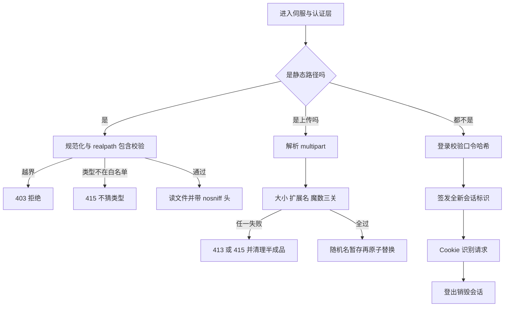

### Q2928 · API 网关的转发骨架: 选路改写超时与错误映射

> 难度:★★★★ | 标签:API 网关, 转发, 容错

**问**:手写一个 API 网关的转发骨架: 按前缀选上游、改写请求头、设置超时并把上游故障映射成正确状态码。

**答**:选路用最长前缀优先, 否则 /api/users/ 会抢走 /api/users/admin/ 该去的专用上游; 无匹配路由给 404 而不是硬猜。头改写四件事: 剥掉 hop-by-hop 头因为它们只对单跳链路有意义; X-Forwarded-For 在链尾追加客户端 IP 而不是覆盖, 保留完整代理链, 且头名匹配要大小写不敏感; Host 换成上游地址, 原值搬进 X-Forwarded-Host; 协议写入 X-Forwarded-Proto。错误映射按故障性质分: 上游连不上是 502, 上游超时是 504, 网关自身没配置好才是 500, 客户端能从状态码直接读出该重试还是该找运维。真实实现里上游调用要带连接与读超时, 演示用异常模拟两类故障。

```python
# file: code/03_Web后端开发/q2928_gateway_forward.py
"""API 网关的转发骨架: 前缀路由、头改写、超时与错误映射(纯标准库, 上游用函数模拟)。"""
import time

HOP_BY_HOP = {"connection", "keep-alive", "proxy-authenticate", "proxy-authorization",
              "te", "trailer", "transfer-encoding", "upgrade"}


class UpstreamDown(Exception):
    pass


class UpstreamTimeout(Exception):
    pass


def select_upstream(path, route_table):
    """最长前缀优先, 避免短前缀抢走长路径。"""
    best = None
    for prefix in route_table:
        if path.startswith(prefix) and (best is None or len(prefix) > len(best)):
            best = prefix
    return best


def forward(request, route_table, timeout_ms=2000):
    """网关转发骨架: 选路 -> 改写 -> 调上游 -> 错误映射, 返回统一响应字典。"""
    prefix = select_upstream(request["path"], route_table)
    if prefix is None:
        return {"status": 404, "body": {"error": "no route"}}
    upstream, host = route_table[prefix]

    fwd_path = "/" + request["path"][len(prefix):]
    # 头名统一小写处理, 避免大小写变体漏改写
    headers = {k.lower(): v for k, v in request["headers"].items()
               if k.lower() not in HOP_BY_HOP}
    xff = headers.get("x-forwarded-for")
    headers["x-forwarded-for"] = (xff + ", " if xff else "") + request["client_ip"]
    headers["x-forwarded-host"] = headers.pop("host", "gateway.internal")
    headers["x-forwarded-proto"] = request.get("scheme", "https")
    headers["host"] = host

    start = time.monotonic()
    try:
        resp = upstream({"method": request["method"], "path": fwd_path,
                         "headers": headers, "body": request.get("body")})
    except UpstreamDown:
        return {"status": 502, "body": {"error": "upstream unavailable"}}
    except UpstreamTimeout:
        return {"status": 504, "body": {"error": "upstream timeout"}}
    spent = int((time.monotonic() - start) * 1000)
    if spent > timeout_ms:
        return {"status": 504, "body": {"error": "gateway timeout"}}
    return resp


def users_upstream(req):
    """模拟用户服务: 回显网关改写后的头, 验证透传正确。"""
    h = req["headers"]
    return {"status": 200,
            "body": {"path": req["path"], "xff": h.get("x-forwarded-for"),
                     "host": h.get("host")}}


def orders_upstream(req):
    raise UpstreamDown("order db connection refused")


def payments_upstream(req):
    raise UpstreamTimeout("read timeout after 2s")


ROUTES = {
    "/api/users/": (users_upstream, "users.svc"),
    "/api/users/admin/": (users_upstream, "admin.svc"),
    "/api/orders/": (orders_upstream, "orders.svc"),
    "/api/payments/": (payments_upstream, "payments.svc"),
}

request = {"method": "GET", "path": "/api/users/42/orders", "headers": {"host": "api.example.com",
           "connection": "keep-alive", "authorization": "Bearer abc"}, "client_ip": "203.0.113.7"}

resp = forward(request, ROUTES)
print("用户服务:", resp["body"])
assert resp["status"] == 200
assert resp["body"]["path"] == "/42/orders", "前缀已剥掉"
assert resp["body"]["xff"] == "203.0.113.7", "首次转发生成 XFF"
assert resp["body"]["host"] == "users.svc"

chained = forward(dict(request, client_ip="198.51.100.9",
                       headers={"host": "api.example.com", "X-Forwarded-For": "203.0.113.7"}), ROUTES)
print("多级链路 XFF:", chained["body"]["xff"])
assert chained["body"]["xff"] == "203.0.113.7, 198.51.100.9", "多级转发在链尾追加, 大小写不敏感"

longest = forward(dict(request, path="/api/users/admin/reset", client_ip="203.0.113.7"), ROUTES)
assert longest["body"]["host"] == "admin.svc", "最长前缀优先命中专用上游"

down = forward(dict(request, path="/api/orders/1", client_ip="1.1.1.1"), ROUTES)
print("上游宕机 ->", down["status"], down["body"]["error"])
assert down["status"] == 502

slow = forward(dict(request, path="/api/payments/1", client_ip="1.1.1.1"), ROUTES)
print("上游超时 ->", slow["status"], slow["body"]["error"])
assert slow["status"] == 504

missing = forward(dict(request, path="/api/unknown/x", client_ip="1.1.1.1"), ROUTES)
assert missing["status"] == 404
print("网关转发骨架演示通过")
```

**追问**:
- X-Forwarded-For 为什么追加而不是覆盖?——覆盖丢失前级链路, 追加才保留完整代理链, 信任判定永远只取可信段内的值。
- 网关该不该解析请求体?——能不解析就不解析, 流式透传保住内存与延迟, 只有内容级路由或改写才付出解析成本。


