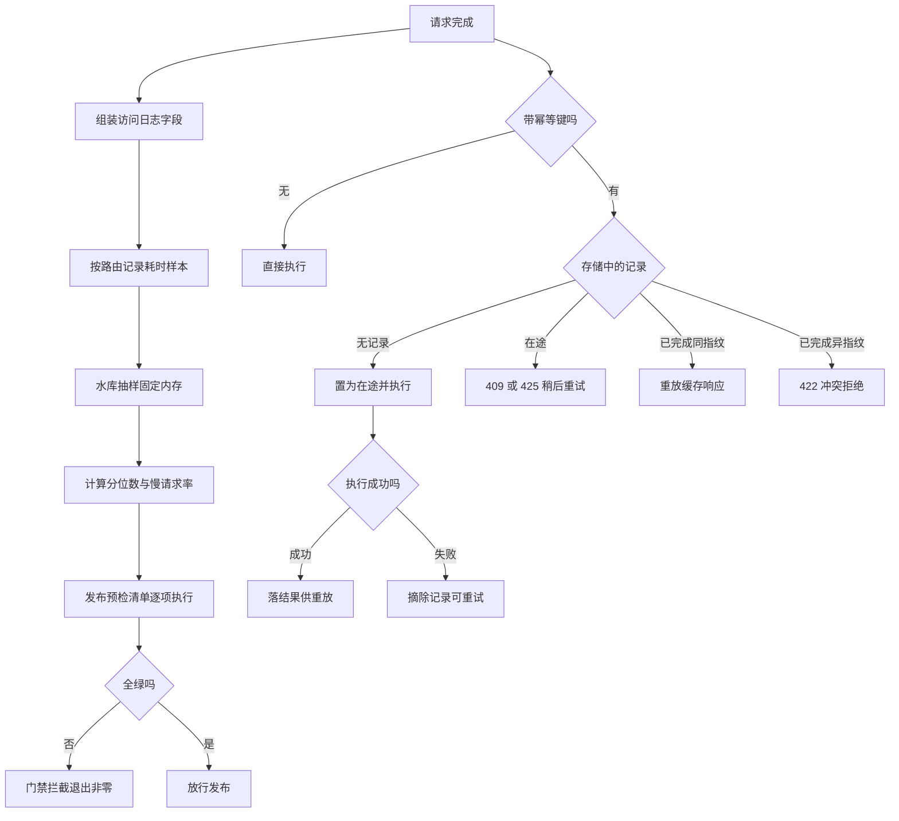

### Q2933 · 优雅发布前的检查脚本: 清单式预检与门禁退出码

> 难度:★★☆☆ | 标签:发布, 预检, 门禁

**问**:优雅发布前你会跑哪些预检? 把它们写成一个脚本, 怎么保证检查器自己坏了也不会误放行?

**答**:预检清单四类: 环境变量齐全、配置可解析且含关键字段、旧实例健康口当前是绿的、数据库迁移版本与代码版本对齐——任何一类不过都不该继续发布。脚本的门禁语义靠退出码表达: 全绿 exit 0, 任何一项挂 exit 非 0, CI 据此拦截发布, 人不参与判断。健壮性的关键一步是检查器自身异常也判失败: 逐项 try/except, 检查函数崩了输出"检查器异常"并计为 FAIL, 绝不静默放行, 因为预检的价值就是把不确定性挡在线下。每项检查输出 PASS 或 FAIL 加一句 detail, 报告直接可贴进发布工单。

```python
# file: code/03_Web后端开发/q2933_release_preflight.py
"""优雅发布前的检查脚本: 清单式预检与门禁退出码(纯标准库)。"""
import json
import sys

REQUIRED_ENV = ["DB_URL", "REDIS_URL", "JWT_SECRET"]


def make_checks(env, config_text, health_status, db_version, code_version):
    """把一次发布的上下文收进闭包, 返回可执行的检查清单。"""

    def check_env():
        missing = [k for k in REQUIRED_ENV if not env.get(k)]
        if missing:
            return False, "缺少环境变量: " + ",".join(missing)
        return True, "必需环境变量齐全"

    def check_config():
        try:
            cfg = json.loads(config_text)
        except ValueError as e:
            return False, "配置不可解析: %s" % e
        if "port" not in cfg:
            return False, "配置缺 port 字段"
        return True, "配置可解析, port=%s" % cfg["port"]

    def check_health():
        """旧实例健康口必须当前是绿的, 否则先修再发。"""
        if health_status != 200:
            return False, "健康口返回 %s" % health_status
        return True, "健康口 200"

    def check_migration():
        if db_version != code_version:
            return False, "库版本 %s 与代码版本 %s 不一致, 先迁移" % (db_version, code_version)
        return True, "迁移版本一致 v%s" % db_version

    return [
        ("环境变量", check_env),
        ("配置可解析", check_config),
        ("旧实例健康", check_health),
        ("迁移对齐", check_migration),
    ]


def run_preflight(checks):
    """逐项执行; 检查器自身崩溃算失败, 绝不静默放行。"""
    results = []
    for name, fn in checks:
        try:
            ok, detail = fn()
        except Exception as exc:
            ok, detail = False, "检查器异常: %s" % exc
        results.append({"check": name, "ok": ok, "detail": detail})
    return results


def report(results, title):
    print("---- %s ----" % title)
    failed = 0
    for r in results:
        mark = "PASS" if r["ok"] else "FAIL"
        if not r["ok"]:
            failed += 1
        print("%s  %s -- %s" % (mark, r["check"], r["detail"]))
    print("结论: %d/%d 通过" % (len(results) - failed, len(results)))
    return failed == 0


green = run_preflight(make_checks(
    env={"DB_URL": "postgres://x", "REDIS_URL": "redis://x", "JWT_SECRET": "s"},
    config_text='{"port": 8000, "workers": 4}',
    health_status=200, db_version=3, code_version=3))
ok_green = report(green, "发布预检: 预期全绿")
assert ok_green

red = run_preflight(make_checks(
    env={"DB_URL": "postgres://x", "REDIS_URL": "", "JWT_SECRET": "s"},
    config_text='{"workers": 4',
    health_status=503, db_version=2, code_version=3))
ok_red = report(red, "发布预检: 预期四项全挂")

assert not ok_red
assert [r["check"] for r in red if not r["ok"]] == ["环境变量", "配置可解析", "旧实例健康", "迁移对齐"]

# 门禁语义: 全绿才退出 0, 任何一项挂即非零, CI 据此拦发布
sys.exit(0 if ok_green else 1)
```

**追问**:
- 预检为什么放在发布流水线里而不是运行时?——预检是门禁, 挂了就停成本最低, 运行时才发现等于把故障发到线上。
- 哪些检查适合预检哪些适合冒烟?——静态事实如配置可解析、版本对齐放预检, 行为事实如登录链路可用放发布后冒烟。


