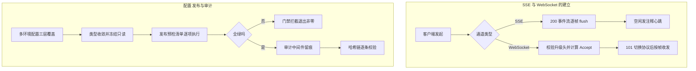

### Q2938 · 审计日志中间件: 变更留痕与哈希链防篡改

> 难度:★★★★ | 标签:审计日志, 中间件, 防篡改

**问**:审计日志和普通访问日志有什么本质区别? 实现一个审计中间件, 怎么保证留痕不可被悄悄篡改?

**答**:本质区别在生命周期与可信要求: 访问日志是排障数据, 可轮转可丢弃; 审计是合规证据, 要回答谁在什么时候对什么做了什么、结果如何, 必须长期留存且防篡改。中间件按两个维度收窄音量: 只审计写方法 POST/PUT/PATCH/DELETE, 只审计敏感前缀如 admin 与 billing, 读流量不进审计; 被拒绝的请求也要留痕——谁尝试过什么本身就是安全信号。防篡改用哈希链: 每条记录的摘要覆盖全部字段并串上前一条摘要, 改任何历史字段或删除中间一条, 后续的 prev 对不上, 逐条校验立刻报出断链位置, 篡改从"悄悄"变成"必然被发现"。生产上再把链头锚点定期写到外部只读存储, 防御整段重写。

```python
# file: code/03_Web后端开发/q2938_audit_middleware.py
"""审计日志中间件: 变更留痕、结果记录与哈希链防篡改(纯标准库)。"""
import hashlib
import json
import time

AUDITED_METHODS = {"POST", "PUT", "PATCH", "DELETE"}
AUDITED_PREFIXES = ("/api/admin/", "/api/billing/")


class AuditTrail:
    """哈希链: 每条记录的摘要覆盖全部字段与前一条摘要, 改任何一条都会断链。"""

    def __init__(self):
        self.records = []
        self._prev = "0" * 64

    def append(self, who, what, when, result):
        record = {"seq": len(self.records) + 1, "prev": self._prev,
                  "who": who, "what": what, "when": when, "result": result}
        payload = {k: v for k, v in record.items()}
        record["digest"] = hashlib.sha256(
            json.dumps(payload, sort_keys=True, ensure_ascii=False).encode()).hexdigest()
        self._prev = record["digest"]
        self.records.append(record)
        return record

    def verify(self):
        prev = "0" * 64
        for record in self.records:
            body = {k: v for k, v in record.items() if k != "digest"}
            expect = hashlib.sha256(
                json.dumps(body, sort_keys=True, ensure_ascii=False).encode()).hexdigest()
            if record["prev"] != prev or record["digest"] != expect:
                return False, record["seq"]
            prev = record["digest"]
        return True, None


def audit_middleware(handler, trail):
    """只审计写方法与敏感前缀; 读流量不进审计, 控制音量。"""
    def wrapped(ctx):
        if ctx["method"] not in AUDITED_METHODS or \
                not any(ctx["path"].startswith(p) for p in AUDITED_PREFIXES):
            return handler(ctx)
        response = handler(ctx)
        trail.append(
            who=ctx.get("user", "anonymous"),
            what="%s %s" % (ctx["method"], ctx["path"]),
            when=time.strftime("%Y-%m-%dT%H:%M:%SZ", time.gmtime()),
            result={"status": response["status"], "changed": response.get("changed", [])},
        )
        return response
    return wrapped


def admin_handler(ctx):
    if ctx["path"] == "/api/admin/users/42/role" and ctx["method"] == "POST":
        return {"status": 200, "changed": ["user:42.role->editor"]}
    if ctx["path"] == "/api/billing/refund" and ctx["method"] == "POST":
        return {"status": 403, "changed": []}
    return {"status": 200, "changed": []}


trail = AuditTrail()
app = audit_middleware(admin_handler, trail)

app({"method": "GET", "path": "/api/admin/users", "user": "alice"})       # 读, 不审计
app({"method": "POST", "path": "/api/public/signup", "user": "bob"})      # 非敏感前缀, 不审计
app({"method": "POST", "path": "/api/admin/users/42/role", "user": "alice"})
app({"method": "POST", "path": "/api/billing/refund", "user": "mallory"})  # 失败请求也留痕

print("审计条数:", len(trail.records))
assert len(trail.records) == 2
for rec in trail.records:
    print("审计:", rec["who"], rec["what"], "->", rec["result"])
assert trail.records[0]["who"] == "alice" and trail.records[0]["result"]["changed"] == ["user:42.role->editor"]
assert trail.records[1]["result"]["status"] == 403, "被拒的请求也要审计"

ok, bad_seq = trail.verify()
print("链校验:", ok)
assert ok and bad_seq is None

# 防篡改: 悄悄改一条历史记录的执行者, 链立即断
trail.records[0]["who"] = "nobody"
ok, bad_seq = trail.verify()
print("篡改后链校验: 断在 seq=%s" % bad_seq)
assert not ok and bad_seq == 1

# 删除中间一条同样会断链
trail2 = AuditTrail()
app2 = audit_middleware(admin_handler, trail2)
for ctx in [
    {"method": "POST", "path": "/api/admin/users/42/role", "user": "alice"},
    {"method": "POST", "path": "/api/admin/users/43/role", "user": "alice"},
    {"method": "POST", "path": "/api/admin/users/44/role", "user": "alice"},
]:
    app2(ctx)
del trail2.records[1]
ok, bad_seq = trail2.verify()
assert not ok and bad_seq == 3, "删除 seq=2 后, seq=3 的 prev 与前条摘要对不上"
print("删链中断在 seq=%s" % bad_seq)
print("审计中间件演示通过")
```

**追问**:
- 审计日志与访问日志为什么分开放?——审计是合规证据要防篡改长期留存, 访问日志是排障数据可轮转丢弃, 生命周期完全不同。
- 失败请求为什么也审计?——谁在什么时候尝试了什么本身就是安全信号, 只记成功会让探测与越权尝试完全隐身。


