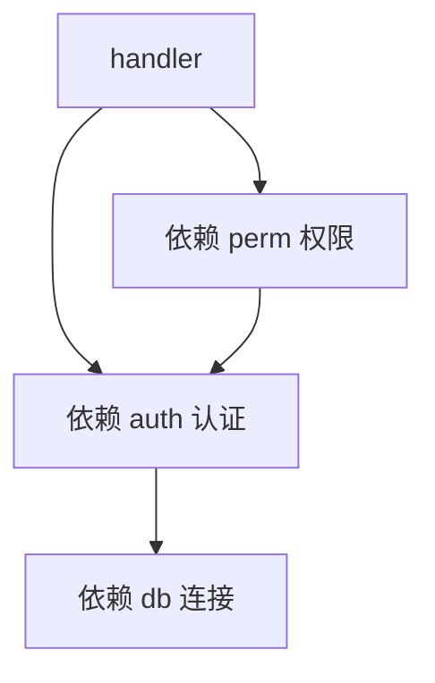

### Q711 · 嵌套依赖与依赖树解析顺序

> 难度:★★★☆ | 标签:FastAPI, 依赖注入

**问**:FastAPI 的依赖可以嵌套依赖,请讲讲它解析一棵依赖树的顺序,以及同一依赖被多个分支引用时会发生什么?

**答**:FastAPI 按**深度优先**逐个解析依赖:先解析 handler 直接声明的依赖,再递归解析每个依赖的子依赖,全部完成后才执行 handler。同一请求内,同一个依赖默认只解析一次(`use_cache=True`),即使它被多个分支引用,所有分支拿到的是**同一个返回对象**。解析失败的依赖会短路整个请求,后面的依赖和 handler 都不会执行。路由级、全局依赖会在路径操作依赖之前解析。



```python
# file: code/03_Web后端开发/q711_nested_dep.py
try:
    from fastapi import Depends, FastAPI
    from fastapi.testclient import TestClient
except ImportError:
    print("pip install fastapi httpx 后再运行")
    raise SystemExit(0)

calls = []
app = FastAPI()

def dep_db():
    calls.append("db")
    return "db-conn"

def dep_auth(db: str = Depends(dep_db)):
    calls.append("auth")
    return f"user@{db}"

def dep_perm(user: str = Depends(dep_auth)):
    calls.append("perm")
    return f"perm[{user}]"

@app.get("/only-auth")
def only_auth(user: str = Depends(dep_auth)):
    return {"user": user}

@app.get("/with-perm")
def with_perm(p: str = Depends(dep_perm), user: str = Depends(dep_auth)):
    return {"p": p, "user": user}

client = TestClient(app)
print(client.get("/only-auth").json())
print(client.get("/with-perm").json())
print("解析顺序:", calls)  # 同一请求内 db 与 auth 只解析一次
```

**追问**:
- 依赖树是并行解析的吗?——不是,串行深度优先,框架没有做并行,所以依赖链太长会叠加延迟。
- 两个分支想拿到两个独立实例怎么办?——给其中一个 `Depends(fn, use_cache=False)`,或让依赖返回可复制语义的对象。
