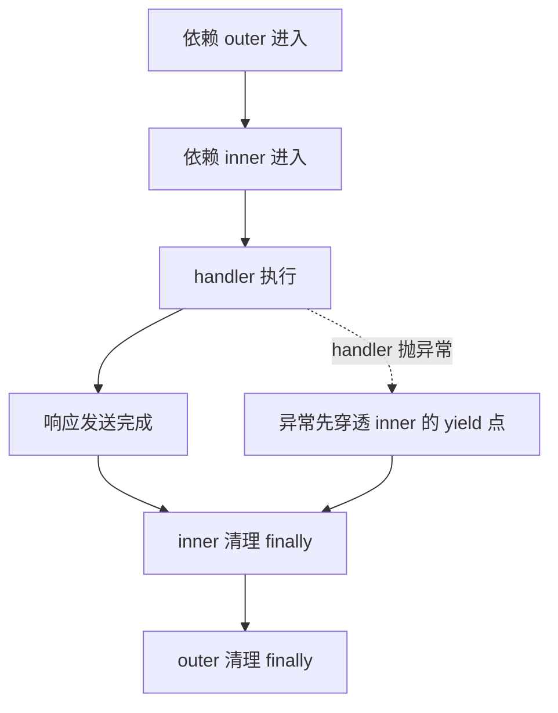

### Q712 · yield 依赖的清理顺序与异常传播

> 难度:★★★☆ | 标签:FastAPI, 依赖注入, 资源管理

**问**:多个 yield 依赖的清理代码按什么顺序执行?handler 抛异常时,依赖里的 yield 能感知到吗?

**答**:yield 依赖的 `yield` 之前是"进入"阶段,之后是"清理"阶段;多个依赖的清理按**进入的逆序(LIFO)**执行,和 `contextmanager` 嵌套语义一致。handler 或后续依赖抛出的异常会**穿透 yield 点**传播进依赖,可以在 `except` 里捕获感知;`finally` 则无论如何都会执行。清理代码在**响应发送完成之后**运行,所以里面只能做资源释放和记日志,不能再修改响应。



```python
# file: code/03_Web后端开发/q712_yield_teardown.py
try:
    from fastapi import Depends, FastAPI
    from fastapi.testclient import TestClient
except ImportError:
    print("pip install fastapi httpx 后再运行")
    raise SystemExit(0)

log = []
app = FastAPI()

def dep_outer():
    log.append("outer: enter")
    try:
        yield "outer"
    finally:
        log.append("outer: exit")

def dep_inner():
    log.append("inner: enter")
    try:
        yield "inner"
        log.append("inner: after-yield-正常")
    except Exception:
        log.append("inner: 捕获到 handler 异常")
        raise
    finally:
        log.append("inner: finally")

@app.get("/ok")
def ok(a: str = Depends(dep_outer), b: str = Depends(dep_inner)):
    return {"a": a, "b": b}

@app.get("/boom")
def boom(a: str = Depends(dep_outer), b: str = Depends(dep_inner)):
    raise RuntimeError("业务异常")

client = TestClient(app, raise_server_exceptions=False)
print(client.get("/ok").json())
print(client.get("/boom").status_code)
print("\n".join(log))
```

**追问**:
- 清理阶段再抛异常会怎样?——异常发生在响应已发出之后,无法改变响应,只会被服务器记录,所以清理代码要自己兜底 try。
- 想在依赖里提交数据库事务,yield 后 commit 可靠吗?——可靠且是标准做法,但注意事务周期横跨整个响应过程,长事务要谨慎。
