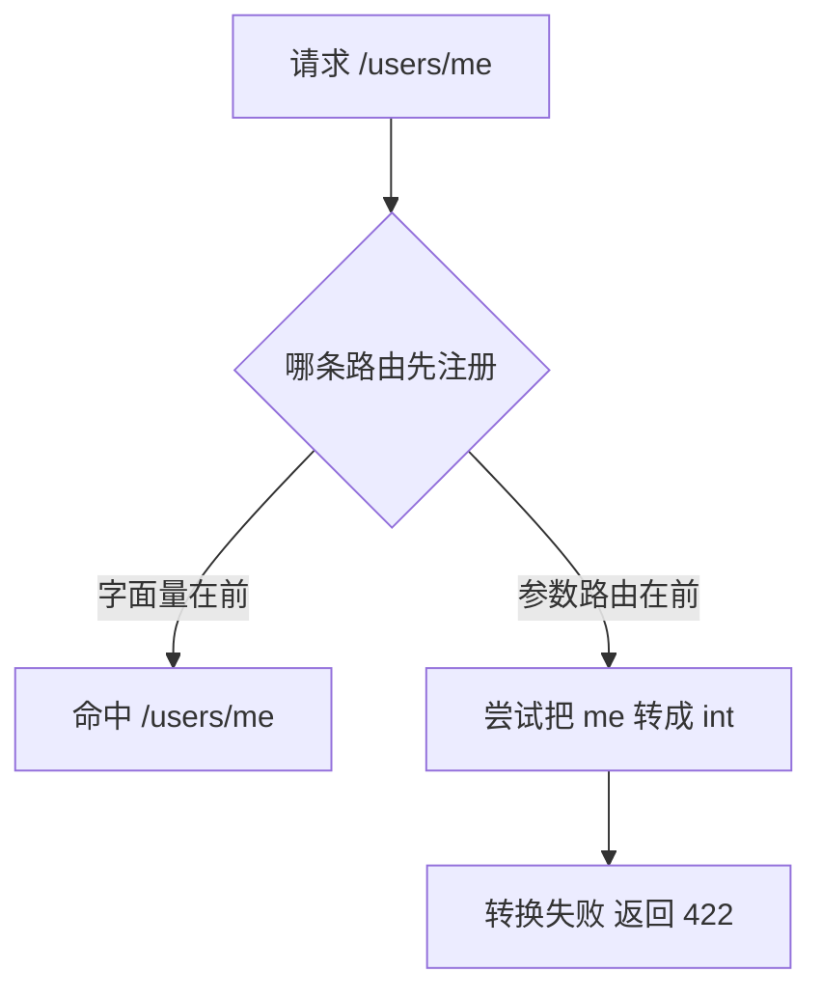

### Q718 · 路由匹配顺序与字面量路径遮蔽

> 难度:★★★☆ | 标签:FastAPI, 路由匹配

**问**:`/users/me` 和 `/users/{user_id}` 同时存在时,声明顺序重要吗?匹配失败表现是什么?

**答**:路由按**注册顺序**匹配,第一个命中的路由接管请求,所以字面量路径必须声明在参数路径**之前**,否则 `/users/me` 会被参数路由吃掉。参数路由类型转换失败返回 **422** 而不是继续尝试下一条路由,这与很多人直觉相反。想拦截数字以外的值,给 Path 参数加 `pattern` 约束,或声明为 str 类型自行判断。



```python
# file: code/03_Web后端开发/q718_route_order.py
try:
    from fastapi import APIRouter, FastAPI
    from fastapi.testclient import TestClient
except ImportError:
    print("pip install fastapi httpx 后再运行")
    raise SystemExit(0)

app = FastAPI()

@app.get("/users/me")          # 必须先注册字面量
def me():
    return {"who": "me"}

@app.get("/users/{user_id}")   # 再注册参数路由
def user(user_id: int):
    return {"user_id": user_id}

client = TestClient(app)
print(client.get("/users/me").json())
print(client.get("/users/42").json())
print(client.get("/users/abc").status_code)  # 参数路由 422, 不会回落到字面量
```

**追问**:
- 想让 `/users/abc` 返回 404 而不是 422 怎么办?——把参数声明为 str,在 handler 里做语义判断抛 404,或用 Path 的 pattern 约束并接受 422 语义。
- 路由多了以后顺序怎么管理?——固定路径集中注册在参数路径之前,或在 CI 里加一条"字面量优先"的 lint 规则。
