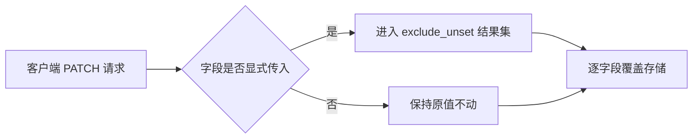

### Q724 · 嵌套模型的 PATCH 更新与 exclude_unset

> 难度:★★★★ | 标签:Pydantic v2, PATCH

**问**:PATCH 接口"只更新客户端传了的字段",为什么 exclude_unset 是关键字?它和 exclude_defaults 差在哪?

**答**:`exclude_unset` 只保留**调用方显式传入**的字段,这是 PATCH 语义的正确工具;`exclude_defaults` 会把"显式传了但恰好等于默认值"的字段也丢掉,二者在"传 null 清空字段"场景表现完全不同:显式传 None 想清空,必须用 exclude_unset 才能保留。exclude_unset 对**嵌套子模型递归生效**,但"嵌套对象整体传入会整体替换"这个坑要靠在视图层拆解处理。FastAPI 里配合 `Body(embed=True)` 或专用 Patch 模型使用。



```python
# file: code/03_Web后端开发/q724_partial_update.py
try:
    from pydantic import BaseModel
except ImportError:
    print("pip install pydantic v2 后再运行")
    raise SystemExit(0)

class UserPatch(BaseModel):
    name: str | None = None
    email: str | None = None
    age: int | None = None

stored = {"name": "alice", "email": "a@x.com", "age": 30}

def apply_patch(stored: dict, patch: UserPatch) -> dict:
    for k, v in patch.model_dump(exclude_unset=True).items():
        stored[k] = v
    return stored

print(apply_patch(dict(stored), UserPatch(name="bob")))   # 只改 name
print(apply_patch(dict(stored), UserPatch(email=None)))   # 显式 None 才清空
```

**追问**:
- 客户端没传和传了 null 怎么区分?——`model_fields_set` 集合记录了显式传入的字段,序列化和更新逻辑都应以它为准。
- 嵌套对象想部分更新怎么办?——先取出已有子对象,把传入合并后再校验,或前端约定嵌套必须整传。
