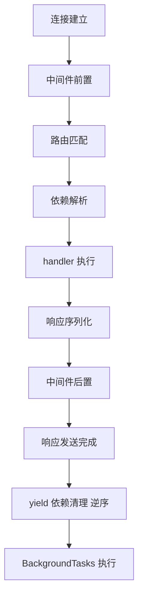

### Q728 · 请求生命周期全景

> 难度:★★★★ | 标签:FastAPI, 生命周期

**问**:一个请求从进来到离开,FastAPI 里各环节的顺序是什么?依赖清理和后台任务排在哪?

**答**:顺序是:**中间件前置 → 路由匹配 → 依赖解析(yield 前半) → handler → 响应序列化 → 中间件后置 → 响应发送完成 → yield 依赖清理(逆序) → BackgroundTasks**。理解这条链能解释很多"怪现象":中间件后置代码在依赖清理之前跑;清理慢不拖慢客户端感知但占资源;后台任务在响应后才执行,失败客户端无感。异常发生时按洋葱向外传播,清理仍会执行。



```python
# file: code/03_Web后端开发/q728_lifecycle.py
try:
    from fastapi import Depends, FastAPI, Request
    from fastapi.testclient import TestClient
except ImportError:
    print("pip install fastapi httpx 后再运行")
    raise SystemExit(0)

events = []
app = FastAPI()

@app.middleware("http")
async def trace_mw(request: Request, call_next):
    events.append("mw: before")
    request.state.events = events
    resp = await call_next(request)
    events.append("mw: after")
    return resp

def dep(request: Request):
    request.state.events.append("dep")

@app.get("/ping")
def ping(request: Request, _=Depends(dep)):
    request.state.events.append("handler")
    return {"ok": True}

client = TestClient(app)
client.get("/ping")
print(events)
```

**追问**:
- 为什么清理和后台任务都压到响应之后?——避免客户端等资源释放,代价是清理代码不能假设请求上下文仍可用。
- 中间件后置能改响应体吗?——能改 BaseHTTPMiddleware 返回的 Response 对象头,但此时流式响应体尚未消费,改体要小心。
