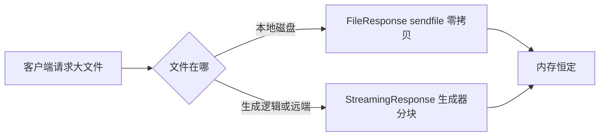

### Q733 · 大文件流式下载与 FileResponse

> 难度:★★★☆ | 标签:FastAPI, 流式响应

**问**:下载几个 G 的文件,接口怎么写才不会把内存打爆?FileResponse 和 StreamingResponse 怎么选?

**答**:核心是**分块**:StreamingResponse 接收生成器,边生成边发送,内存占用恒定;但本地静态大文件首选 `FileResponse`,它走操作系统 **sendfile 零拷贝**,更快且省 CPU。生成器里不能有同步阻塞 IO,否则卡死事件循环;无法预知 Content-Length 时服务器自动 chunked 编码。文件名、类型头配好 `Content-Disposition`,配合下一题的 Range 才是完整方案。



```python
# file: code/03_Web后端开发/q733_stream_download.py
try:
    from fastapi import FastAPI
    from fastapi.responses import StreamingResponse
    from fastapi.testclient import TestClient
except ImportError:
    print("pip install fastapi httpx 后再运行")
    raise SystemExit(0)

app = FastAPI()

def chunk_file(total_kb: int, chunk_kb: int = 8):
    for _ in range(0, total_kb, chunk_kb):
        yield b"x" * (chunk_kb * 1024)

@app.get("/download")
def download():
    return StreamingResponse(
        chunk_file(32),
        media_type="application/octet-stream",
        headers={"Content-Disposition": 'attachment; filename="blob.bin"'},
    )

client = TestClient(app)
r = client.get("/download")
print(r.status_code, len(r.content), r.headers["content-type"])
```

**追问**:
- 生成器中途抛异常怎么办?——响应已发部分无法撤回,连接中断,只能记日志,设计上尽量在响应前完成可能失败的准备动作。
- 为什么 FileResponse 更快?——它设置 sendfile 标志,数据从页缓存直接进网卡,不经过 Python 内存拷贝。
