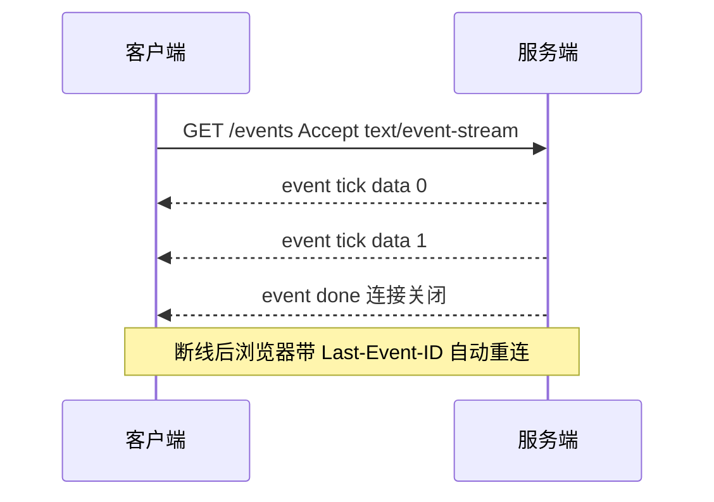

### Q735 · SSE 服务端推送

> 难度:★★★★ | 标签:FastAPI, SSE, 实时通信

**问**:AI 流式输出、任务进度推送这类场景,SSE 怎么实现?和 WebSocket 怎么选?

**答**:SSE 是**单向 HTTP 长连接**:`Content-Type: text/event-stream`,消息以 `data:` 行加空行分隔,用 StreamingResponse 输出 async 生成器即可。相比 WebSocket,SSE 更简单,天然兼容 HTTP 基础设施(鉴权、代理、证书),浏览器自带断线重连并携带 `Last-Event-ID`;只需要服务端到客户端推送(行情、进度、LLM 输出)就选 SSE,需要双向低延迟再上 WebSocket。反向代理必须**关闭响应缓冲**,否则消息被攒住不吐。



```python
# file: code/03_Web后端开发/q735_sse.py
import asyncio
try:
    from fastapi import FastAPI
    from fastapi.responses import StreamingResponse
    from fastapi.testclient import TestClient
except ImportError:
    print("pip install fastapi httpx 后再运行")
    raise SystemExit(0)

app = FastAPI()

async def tick(n: int):
    for i in range(n):
        yield f"event: tick\ndata: {{\"i\": {i}}}\n\n"
        await asyncio.sleep(0.01)
    yield "event: done\ndata: bye\n\n"

@app.get("/events")
def events():
    return StreamingResponse(
        tick(3),
        media_type="text/event-stream",
        headers={"Cache-Control": "no-cache"},
    )

client = TestClient(app)
with client.stream("GET", "/events") as r:
    body = "".join(r.iter_text())
print(body.strip().replace("\n", " | "))
```

**追问**:
- SSE 怎么做心跳?——定期 yield 一个注释行 `: ping` 或 event: ping,既保活又穿透代理的空闲超时。
- SSE 能双向吗?——不能,上行用普通 HTTP 请求即可,不必要地用 WebSocket 会增加运维复杂度。
