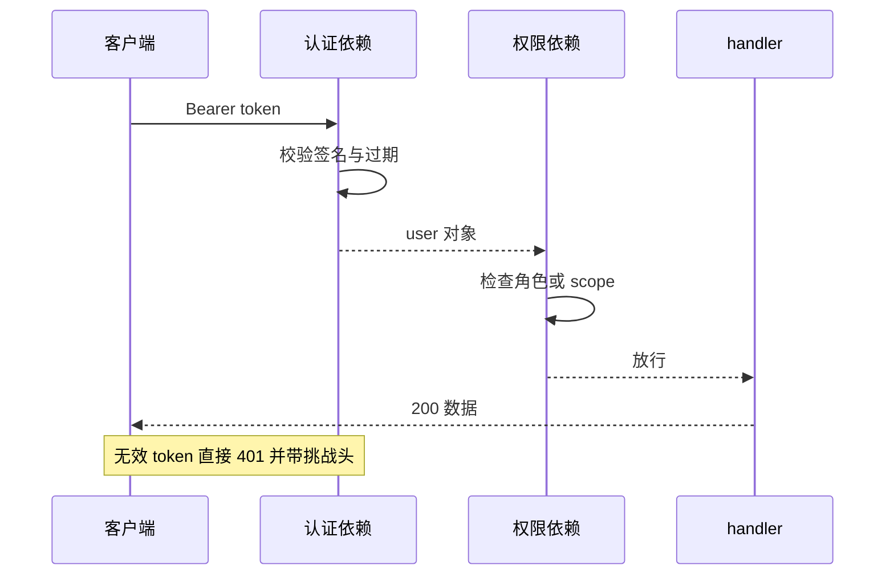

### Q738 · 认证依赖链与 401/403 语义

> 难度:★★★★ | 标签:FastAPI, 认证, 授权

**问**:从 token 到"这个用户能不能删这条数据",FastAPI 里正确的依赖分层是什么?401 和 403 怎么区分?

**答**:分三层:`OAuth2PasswordBearer` 只负责**提取 token**;`get_current_user` 负责解析、验证并抛 401(未认证,必须带 `WWW-Authenticate: Bearer` 响应头);权限依赖在 current_user 之上做角色/scope 检查,失败抛 **403**(已认证但无权限)。handler 只依赖最高层语义,不碰原始 token。这条链让认证策略集中在依赖里,handler 保持纯粹。



```python
# file: code/03_Web后端开发/q738_auth_chain.py
try:
    from fastapi import Depends, FastAPI, HTTPException, status
    from fastapi.security import OAuth2PasswordBearer
    from fastapi.testclient import TestClient
except ImportError:
    print("pip install fastapi httpx 后再运行")
    raise SystemExit(0)

app = FastAPI()
oauth2 = OAuth2PasswordBearer(tokenUrl="/login")
FAKE = {"token1": {"username": "alice", "role": "admin"},
        "token2": {"username": "bob", "role": "user"}}

async def get_current_user(token: str = Depends(oauth2)) -> dict:
    user = FAKE.get(token)
    if not user:
        raise HTTPException(status_code=status.HTTP_401_UNAUTHORIZED,
                            headers={"WWW-Authenticate": "Bearer"})
    return user

async def require_admin(user: dict = Depends(get_current_user)) -> dict:
    if user["role"] != "admin":
        raise HTTPException(status_code=status.HTTP_403_FORBIDDEN)
    return user

@app.get("/me")
def me(user: dict = Depends(get_current_user)):
    return user

@app.delete("/items/{iid}")
def del_item(iid: int, user: dict = Depends(require_admin)):
    return {"deleted": iid, "by": user["username"]}

client = TestClient(app)
print(client.get("/me", headers={"Authorization": "Bearer token1"}).json())
print(client.get("/me").status_code)                                  # 401
print(client.delete("/items/1", headers={"Authorization": "Bearer token2"}).status_code)  # 403
```

**追问**:
- token 过期和 token 无效都返回 401 吗?——都返回 401,细分原因放 body 的 detail,避免向攻击者暴露 token 状态细节。
- 为什么不在 handler 里直接判断角色?——散落各处无法统一审计和测试,权限必须收敛到依赖或中间件一层。
