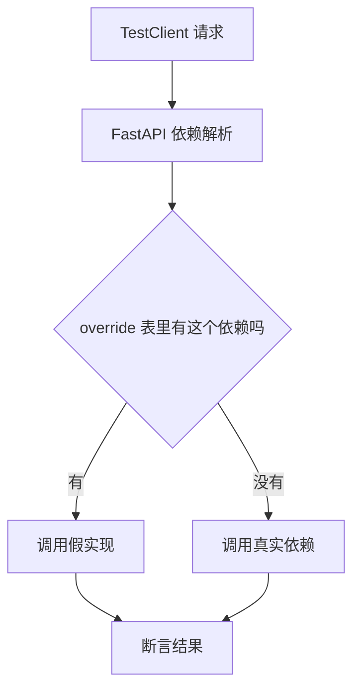

### Q745 · dependency_overrides 依赖覆盖测试

> 难度:★★★☆ | 标签:FastAPI, 测试, 依赖注入

**问**:怎么在不改业务代码的情况下,把测试里的数据库、外部服务替换成假实现?

**答**:`app.dependency_overrides[原依赖] = 假实现` 是 FastAPI 内置的依赖替换机制,键是**依赖函数对象**,值是替代函数;覆盖**子依赖会自动作用于整棵依赖树**,所以只需替换最底层的 get_db / get_client。测试结束 `clear()` 恢复,pytest 里做成 fixture 最稳。这个机制的前提是业务按依赖倒置组织——所有资源访问都从依赖拿,测试才有的放矢。



```python
# file: code/03_Web后端开发/q745_dep_override.py
try:
    from fastapi import Depends, FastAPI
    from fastapi.testclient import TestClient
except ImportError:
    print("pip install fastapi httpx 后再运行")
    raise SystemExit(0)

def get_db():
    raise RuntimeError("测试中不应触达真库")

app = FastAPI()

@app.get("/users")
def users(db: str = Depends(get_db)):
    return {"db": db}

app.dependency_overrides[get_db] = lambda: "fake-db"

client = TestClient(app)
print(client.get("/users").json())
app.dependency_overrides.clear()
```

**追问**:
- 中间件和 lifespan 也能覆盖吗?——不能,override 只作用于依赖体系,中间件要靠环境变量/配置注入开关。
- 假实现和 monkeypatch 替换模块函数哪个好?——依赖覆盖更显式、不污染全局状态、恢复容易,优先用前者。
