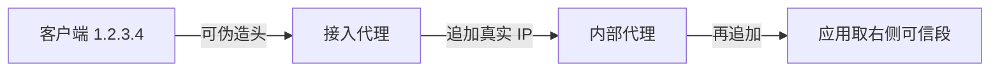

### Q757 · 代理后的真实客户端 IP

> 难度:★★★★ | 标签:FastAPI, 代理, 安全

**问**:限流和审计都依赖客户端 IP,经过 Nginx 后怎么取才是对的?为什么不能取 X-Forwarded-For 第一个值?

**答**:`X-Forwarded-For` 是**客户端可以随意伪造的请求头**,每一跳代理只是追加。取第一个值等于信攻击者。正确规则:只信任**自己部署的代理写入的部分**——已知可信代理层数 N,取列表右侧倒数第 N 个;直连场景用 `request.client.host`。Uvicorn 开 `--proxy-headers --forwarded-allow-ips=网段` 会自动修正 request.client。IP 参与限流、风控、审计,取错直接造成封禁绕过或误杀。



```python
# file: code/03_Web后端开发/q757_client_ip.py
try:
    from fastapi import FastAPI, Request
    from fastapi.testclient import TestClient
except ImportError:
    print("pip install fastapi httpx 后再运行")
    raise SystemExit(0)

TRUSTED_PROXIES = 1  # 信任的代理层数

def client_ip(request: Request) -> str:
    forwarded = request.headers.get("x-forwarded-for", "")
    if forwarded:
        parts = [p.strip() for p in forwarded.split(",")]
        return parts[-TRUSTED_PROXIES]   # 取右侧可信层写入的地址
    return request.client.host if request.client else "unknown"

app = FastAPI()

@app.get("/ip")
def ip(request: Request):
    return {"ip": client_ip(request)}

client = TestClient(app)
r = client.get("/ip", headers={"X-Forwarded-For": "1.2.3.4, 10.0.0.9"})
print(r.json())  # 不取被伪造的 1.2.3.4
```

**追问**:
- X-Real-IP 可以信吗?——它同样只是请求头,除非由你的代理强制覆盖写入,否则和 XFF 一样不可信。
- 多层 CDN 场景怎么配?——每一层都记录并保留链路,按真实部署的代理拓扑定 N,并定期核对拓扑变更。
