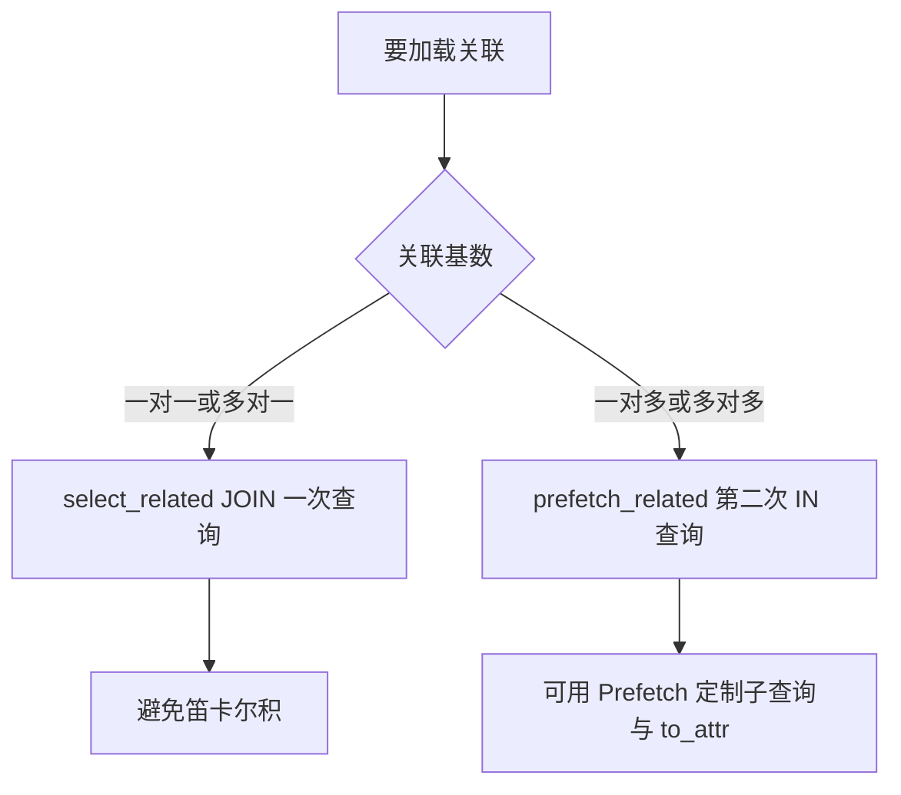

### Q761 · select_related 与 prefetch_related 深水区

> 难度:★★★★ | 标签:Django ORM, N+1

**问**:select_related 和 prefetch_related 的底层机制差异是什么?各自的适用边界与误用后果?

**答**:`select_related` 生成 **SQL JOIN**,一次查询把关联行取回,适合 ForeignKey/OneToOne;`prefetch_related` 做**第二次 IN 查询**后在 Python 层拼接,适合 M2M 与反向外键。误用方向相反:该 join 的用 prefetch 变两次查询(尚可),对反向一对多/M2M 误用 select_related 会直接抛 `FieldError`(它只接正向 ForeignKey/OneToOne);JOIN 行数膨胀是手写 JOIN 或 SQLAlchemy `joinedload` 的问题,不是 Django select_related 的行为。进阶手段是 `Prefetch` 对象:给关联注入过滤条件的子 QuerySet,或用 `to_attr` 缓存成列表避免重复取。



```python
# file: code/03_Web后端开发/q761_select_related.py
try:
    import django
    from django.conf import settings
except ImportError:
    print("该题演示需要第三方库 django:pip install django,原理见正文")
    raise SystemExit(0)

settings.configure(
    DEBUG=True,
    DATABASES={"default": {"ENGINE": "django.db.backends.sqlite3", "NAME": ":memory:"}},
    INSTALLED_APPS=[],
    USE_TZ=True,
)
django.setup()

from django.db import connection, models

class Author(models.Model):
    name = models.CharField(max_length=32)
    class Meta:
        app_label = "demo"

class Book(models.Model):
    title = models.CharField(max_length=64)
    author = models.ForeignKey(Author, on_delete=models.CASCADE)
    class Meta:
        app_label = "demo"

with connection.schema_editor() as se:
    se.create_model(Author)
    se.create_model(Book)

a = Author.objects.create(name="鲁迅")
Book.objects.bulk_create([Book(title=f"书{i}", author=a) for i in range(3)])

connection.queries_log.clear()
for b in Book.objects.select_related("author"):
    _ = b.author.name
print("select_related 查询数:", len(connection.queries))

connection.queries_log.clear()
for b in Book.objects.prefetch_related("author"):
    _ = b.author.name
print("prefetch_related 查询数:", len(connection.queries))
```

**追问**:
- prefetch_related 传 ForeignKey 会怎样?——能跑但退化为额外 IN 查询,不如 select_related 的一条 JOIN。
- Prefetch 的 to_attr 解决什么?——把结果挂到自定义列表属性,比默认缓存描述符更省内存且可预排序。
