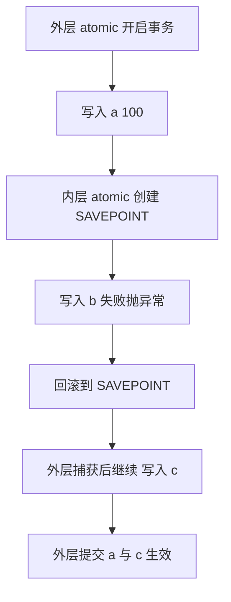

### Q767 · 事务 atomic、嵌套与保存点

> 难度:★★★★ | 标签:Django ORM, 事务

**问**:atomic 可以嵌套吗?嵌套时内部回滚外部还在,这是什么机制?ATOMIC_REQUESTS 的取舍?

**答**:`transaction.atomic()` 可嵌套:最外层开 BEGIN,内层变成 **SAVEPOINT**,内层异常回滚到保存点、外层可以捕获后继续,这是"局部失败不拖垮整体"的标准手段。但**异常若穿透最外层,全部回滚**。`ATOMIC_REQUESTS=True` 把每个请求包进事务,写路径省心,代价是长请求持锁久、第三方慢调用也被卷进事务——大请求应显式管理事务而非依赖它。atomic 块内禁止手动 commit/rollback 和捕获异常后继续用失效连接。



```python
# file: code/03_Web后端开发/q767_atomic_savepoint.py
try:
    import django
    from django.conf import settings
except ImportError:
    print("该题演示需要第三方库 django:pip install django,原理见正文")
    raise SystemExit(0)

settings.configure(
    DEBUG=True,
    DATABASES={"default": {"ENGINE": "django.db.backends.sqlite3", "NAME": ":memory:"}},
    INSTALLED_APPS=[],
    USE_TZ=True,
)
django.setup()

from django.db import connection, models, transaction

class Ledger(models.Model):
    owner = models.CharField(max_length=32)
    amount = models.IntegerField(default=0)
    class Meta:
        app_label = "demo"

with connection.schema_editor() as se:
    se.create_model(Ledger)

try:
    with transaction.atomic():
        Ledger.objects.create(owner="a", amount=100)
        try:
            with transaction.atomic():          # 内层变成 SAVEPOINT
                Ledger.objects.create(owner="b", amount=-1)
                raise ValueError("内层失败")
        except ValueError:
            pass                                 # 只回滚内层
        Ledger.objects.create(owner="c", amount=50)
except ValueError:
    pass

print(list(Ledger.objects.values_list("owner", "amount")))
```

**追问**:
- 怎么判断当前是否已在事务里?——`connection.in_atomic_block`,写库工具方法据此决定是否自己开 atomic。
- SAVEPOINT 回滚后外层还能继续吗?——能,这正是保存点语义;但如果数据库连接本身报错(如死锁)就要整体重来。
