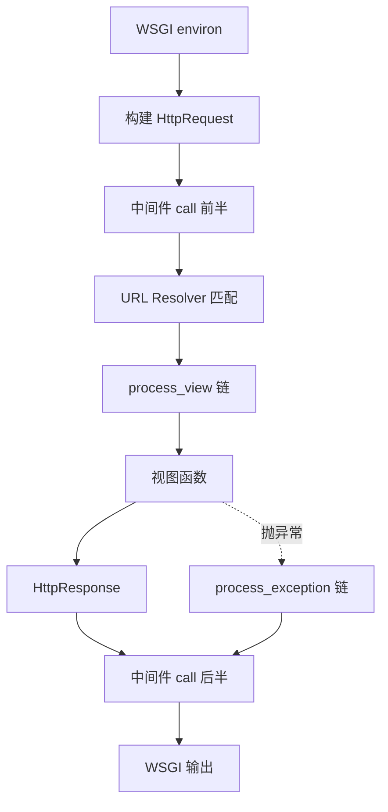

### Q776 · Django 请求到响应的完整管线

> 难度:★★★★ | 标签:Django, 请求生命周期

**问**:从 WSGI handler 进来,一个请求经过哪些环节到响应出去?各层能干预什么?

**答**:管线:WSGIHandler 收到 environ → 构建 HttpRequest → **中间件栈 call 前半** → URL Resolver 匹配 → **process_view 链** → 视图(可读 ORM、触发信号) → 返回 HttpResponse → **中间件 call 后半** → 异常路径则 process_exception 链 → WSGI 输出。每层职责:中间件管横切(会话、CSRF、压缩),URLconf 管映射,视图管编排,模板/序列化管呈现。理解顺序才能解释"为什么会话中间件必须在认证之前"这类约束。



**追问**:
- 为什么 SessionMiddleware 必须在 AuthenticationMiddleware 之前?——认证要从 request.session 读用户,顺序颠倒认证拿不到会话直接失效。
- 视图里抛 Http404 与返回 404 响应有区别吗?——Http404 走异常处理链(会被 process_exception 之后的 handler 与 404 页面渲染处理),直接返回则是普通响应。

```python
# file: code/03_Web后端开发/q776_pipeline_hooks.py
try:
    import django
    from django.conf import settings
except ImportError:
    print("该题演示需要第三方库 django:pip install django,原理见正文")
    raise SystemExit(0)

events = []

class FullHooks:
    def __init__(self, get_response):
        self.get_response = get_response
        events.append("init")

    def __call__(self, request):
        events.append("call-in")
        response = self.get_response(request)
        events.append("call-out")
        return response

    def process_view(self, request, view_func, args, kwargs):
        events.append("process_view")
        return None

    def process_exception(self, request, exception):
        events.append("process_exception")
        return None

settings.configure(
    DEBUG=True,
    ALLOWED_HOSTS=["*"],
    MIDDLEWARE=["__main__.FullHooks"],
    ROOT_URLCONF="__main__",
    DATABASES={"default": {"ENGINE": "django.db.backends.sqlite3", "NAME": ":memory:"}},
    INSTALLED_APPS=[],
    USE_TZ=True,
)
django.setup()

from django.http import HttpResponse
from django.urls import path

def boom(request):
    raise ValueError("视图内异常")

urlpatterns = [path("boom", boom)]

from django.test import Client

c = Client()
c.get("/boom", raise_request_exception=False)
print("钩子触发顺序:", events)
```
