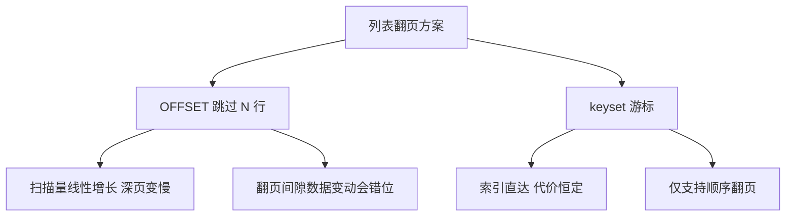

### Q783 · 深分页 OFFSET 的性能问题与 keyset 改造

> 难度:★★★★ | 标签:DRF, 分页, 性能

**问**:LIMIT OFFSET 翻到第 10 万页为什么慢?游标分页的原理和约束?

**答**:OFFSET N 要**扫过并丢弃前 N 行**,页码越深越慢,且翻页间隙数据变动会导致重复/漏行。keyset(游标)分页记住"上一页最后一行的排序键",下一页用 `WHERE sort_key < :cursor ORDER BY sort_key DESC LIMIT n`,索引直达、代价恒定、翻页期间稳定。约束:排序键必须**唯一且有序**(单列唯一或组合键),只支持顺序翻页不能跳页。DRF 的 CursorPagination 即此思想,自定义场景用 `pk__lt` 手写。



```python
# file: code/03_Web后端开发/q783_keyset.py
try:
    import django
    from django.conf import settings
except ImportError:
    print("该题演示需要第三方库 django:pip install django,原理见正文")
    raise SystemExit(0)

settings.configure(
    DEBUG=True,
    DATABASES={"default": {"ENGINE": "django.db.backends.sqlite3", "NAME": ":memory:"}},
    INSTALLED_APPS=[],
    USE_TZ=True,
)
django.setup()

from django.db import connection, models

class Item(models.Model):
    name = models.CharField(max_length=32)
    class Meta:
        app_label = "demo"

with connection.schema_editor() as se:
    se.create_model(Item)

Item.objects.bulk_create([Item(name=f"i{i}") for i in range(20)])

def page(cursor=None, size=5):
    qs = Item.objects.order_by("-id")
    if cursor is not None:
        qs = qs.filter(id__lt=cursor)
    rows = list(qs.values_list("id", flat=True)[:size])
    return rows, rows[-1] if rows else None

page1, cur = page()
page2, _ = page(cur)
print("第一页:", page1)
print("游标后第二页:", page2)
```

**追问**:
- CursorPagination 的 cursor 为什么要签名?——防止客户端篡改排序方向与锚点做注入,签名串里编码了位置参数。
- 业务一定要跳页怎么办?——给管理端用 offset(数据小),C 端列表用 keyset,两者按场景分接口。
