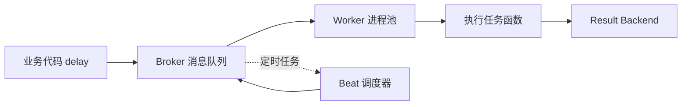

### Q793 · Celery 架构与任务执行链路

> 难度:★★★☆ | 标签:Celery, 任务队列

**问**:画一下 Celery 的架构:一次 delay 调用之后发生了什么?

**答**:链路:业务代码调用 `task.delay(args)` → 任务消息(函数名+参数序列化)投递到 **broker**(Redis/RabbitMQ)→ **worker** 进程消费消息、反序列化、执行函数 → 结果(可选)写入 **result backend** → 业务方用 AsyncResult 取结果。关键概念:任务按名字路由(不传代码),worker 并发模型 prefork/gevent/eventlet,消息 ack 与重投递决定"至少一次"语义——这正是任务必须**幂等**的根因。beat 是独立的定时投递器,与 worker 分离。



```python
# file: code/03_Web后端开发/q793_celery_concepts.py
import queue
import threading
import time

broker: queue.Queue = queue.Queue()
results: dict = {}

def worker(wid: int):
    while True:
        task = broker.get()
        if task is None:
            break
        name, args, task_id = task
        time.sleep(0.01)
        results[task_id] = f"{name} 完成 by worker-{wid} args={args}"
        broker.task_done()

threads = [threading.Thread(target=worker, args=(i,), daemon=True) for i in range(2)]
for t in threads:
    t.start()

def send_task(name: str, *args) -> str:   # producer 视角: 只投递不执行
    tid = f"{name}-1"
    broker.put((name, args, tid))
    return tid

tid = send_task("send_email", "a@b.c")
broker.join()
for _ in threads:
    broker.put(None)
for t in threads:
    t.join()
print(results[tid])
```

**追问**:
- broker 挂了任务会怎样?——delay 抛连接错误,消息不落地;已投递的消息在 broker 持久化配置下可恢复,生产要开持久化与镜像。
- 结果为什么可以不用 backend?——多数业务不关心返回值,靠副作用与状态表即可,省一套存储与过期管理。
