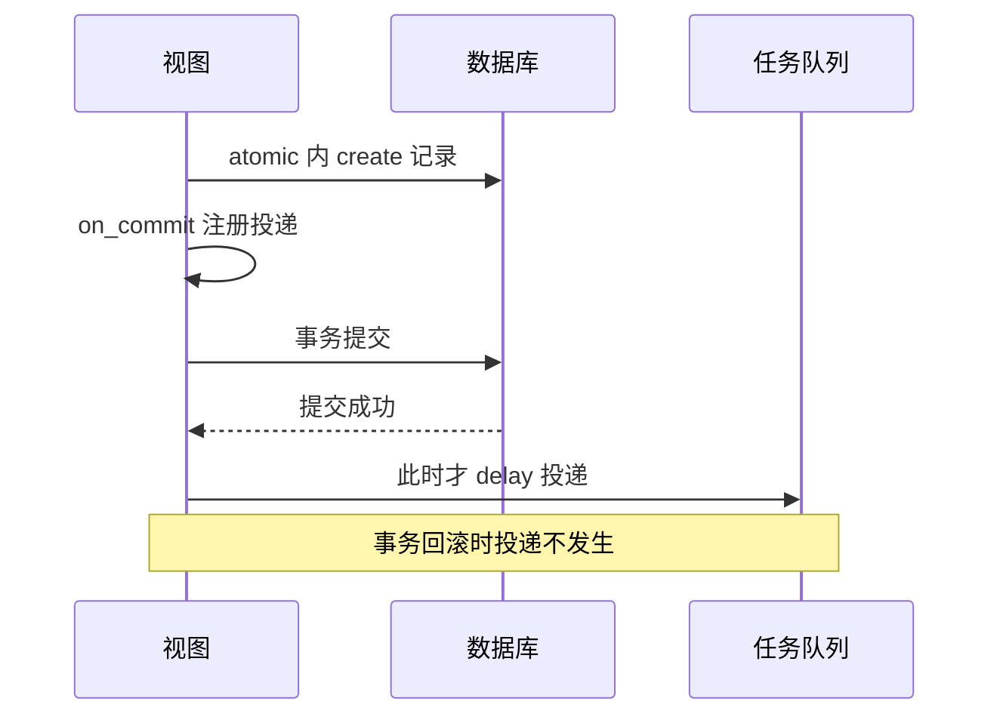

### Q798 · 事务边界:on_commit 再发任务

> 难度:★★★★ | 标签:Django, Celery, 事务

**问**:atomic 里 create 完就 delay 发邮件,为什么会出现"邮件发了记录却没有"?怎么修?

**答**:`delay` 立即投递,但事务**尚未提交**;若事务随后回滚,worker 却已经拿着不存在的数据干活——幽灵消息。修复:`transaction.on_commit(lambda: task.delay(...))`,把投递挂到**提交成功之后**,回滚则不投递。它解决的是"数据库状态与外部副作用的一致性"方向;反方向(worker 先成功、提交失败)要靠下游幂等兜底。测试里 `TestCase` 包事务导致 on_commit 不触发,要用 `captureOnCommitCallbacks` 或 TransactionTestCase。



```python
# file: code/03_Web后端开发/q798_on_commit.py
try:
    import django
    from django.conf import settings
except ImportError:
    print("该题演示需要第三方库 django:pip install django,原理见正文")
    raise SystemExit(0)

settings.configure(
    DEBUG=True,
    DATABASES={"default": {"ENGINE": "django.db.backends.sqlite3", "NAME": ":memory:"}},
    INSTALLED_APPS=[],
    USE_TZ=True,
)
django.setup()

from django.db import connection, models, transaction

class Mail(models.Model):
    to = models.CharField(max_length=64)
    class Meta:
        app_label = "demo"

with connection.schema_editor() as se:
    se.create_model(Mail)

sent: list = []

def dispatch_mail(to: str):
    sent.append(f"mail->{to}")

with transaction.atomic():
    Mail.objects.create(to="a@b.c")
    transaction.on_commit(lambda: dispatch_mail("a@b.c"))
    print("事务未提交时已发送:", len(sent))
print("提交后已发送:", sent)

try:
    with transaction.atomic():
        Mail.objects.create(to="x")
        transaction.on_commit(lambda: dispatch_mail("x"))
        raise RuntimeError("回滚")
except RuntimeError:
    pass
print("回滚后不应发送:", "mail->x" not in sent)
```

**追问**:
- on_commit 的回调顺序?——按注册顺序执行,无嵌套事务时的标准行为;嵌套中只在外层提交时触发。
- 提交后投递前进程崩了怎么办?——消息丢失,要更强保证用事务发件箱(outbox 表+轮询投递),on_commit 是低成本折中。
