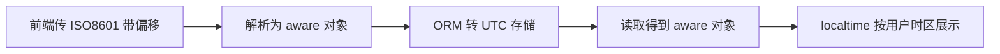
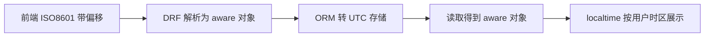

### Q802 · 时区处理:USE_TZ 与 aware datetime

> 难度:★★★★ | 标签:Django, 时区

**问**:USE_TZ=True 之后,数据库存的是什么?naive 和 aware 混用会出什么事?

**答**:USE_TZ=True 时 ORM 把所有 datetime 转成 **UTC 存储**,读出的是带 tzinfo 的 aware 对象;展示层用 `localtime()` 转用户时区(TIME_ZONE 或按用户的 timezone)。**naive 与 aware 比较直接抛 TypeError**,这是最常见的崩溃源;构造 aware 用 `timezone.make_aware` 或 `timezone.now()`,禁止 `datetime.now()`。前端约定传 ISO8601 带偏移量;定时任务用 aware 时间并考虑 DST 跳变。





```python
# file: code/03_Web后端开发/q802_timezone.py
import datetime
try:
    import django
    from django.conf import settings
except ImportError:
    print("该题演示需要第三方库 django:pip install django,原理见正文")
    raise SystemExit(0)

settings.configure(
    DEBUG=True,
    USE_TZ=True,
    TIME_ZONE="Asia/Shanghai",
    INSTALLED_APPS=[],
    DATABASES={"default": {"ENGINE": "django.db.backends.sqlite3", "NAME": ":memory:"}},
)
django.setup()

from django.utils import timezone

naive = datetime.datetime(2026, 1, 1, 8, 0)
aware = timezone.make_aware(naive)
print("aware:", aware.isoformat())
print("转本地时区:", timezone.localtime(aware))
print("now 是 aware:", timezone.now().utcoffset() is not None)
try:
    naive < timezone.now()
except TypeError as e:
    print("混比崩溃:", type(e).__name__)
```

**追问**:
- 为什么坚持全 UTC 存储?——单一时区真相源,多时区展示与跨区计算不歧义,夏令时切换不出重复/缺失时段。
- 前端只传日期不带时区怎么办?——约定按用户时区解释并服务端 make_aware,别存 naive,边界(生日这类纯日期)用 DateField。
