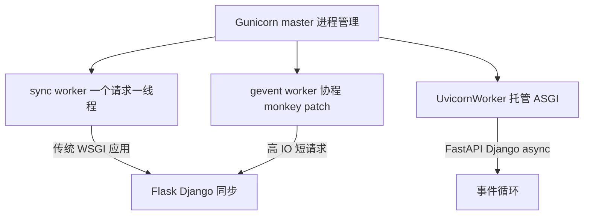

### Q811 · Gunicorn worker 类型深水区

> 难度:★★★★ | 标签:Gunicorn, worker

**问**:sync、gevent、UvicornWorker 三种 worker 的模型差异?各适合什么应用?

**答**:**sync worker** 一个请求占一个进程/线程,模型最简单、行为最可预期,适合 WSGI 应用短请求,并发上限 = worker 数 × threads;**gevent worker** 用协程 monkey patch 把阻塞 IO 变成可切换,单进程扛高 IO 并发,但要求全链路兼容(数据库驱动、C 扩展都可能不配合),且与真正的 asyncio 生态不通;**UvicornWorker** 让 Gunicorn 只做进程管理,事件循环里跑 ASGI 应用,是 FastAPI/Django-async 的标准组合。CPU 密集任何 worker 类型都救不了,要拆进程或下推。



```python
# file: code/03_Web后端开发/q811_worker_types.py
import asyncio
import threading
import time

def sync_io(total: int, delay: float = 0.01) -> None:
    for _ in range(total):
        time.sleep(delay)          # 阻塞式 IO: 串行等待

async def async_io(total: int, delay: float = 0.01) -> None:
    await asyncio.gather(*(asyncio.sleep(delay) for _ in range(total)))

t0 = time.perf_counter()
sync_io(20)
t1 = time.perf_counter()
asyncio.run(async_io(20))
t2 = time.perf_counter()
print(f"sync 模型耗时 {t1 - t0:.2f}s, 事件循环耗时 {t2 - t1:.2f}s")
print("线程演示:", threading.active_count(), "个活动线程")
```

**追问**:
- gevent 的 monkey patch 为什么必须入口第一行?——必须在任何模块导入标准库 socket/threading 之前打补丁,晚打会出现部分代码用真阻塞的混合态。
- UvicornWorker 下还要配 threads 吗?——不需要,事件循环内并发由协程承担,threads 参数对 ASGI worker 无意义。
