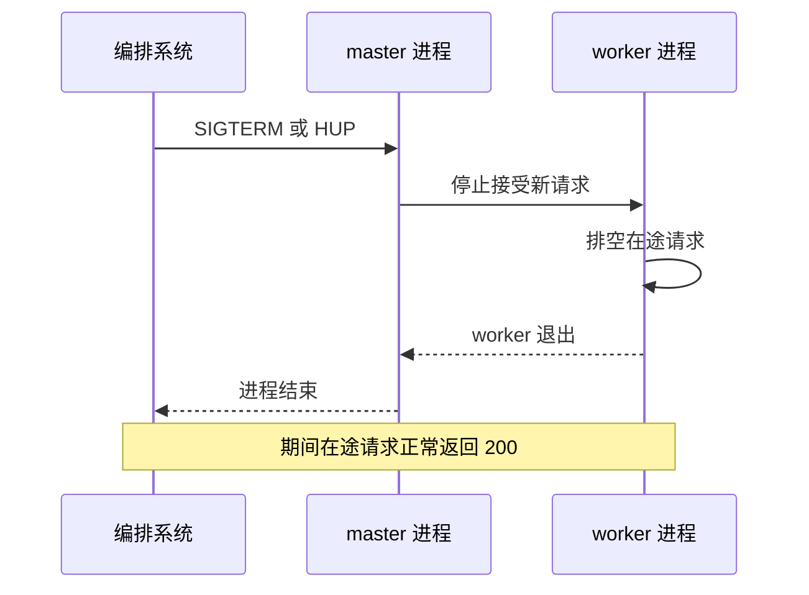

### Q813 · 优雅重启与 SIGTERM 处理

> 难度:★★★★ | 标签:发布, 信号

**问**:滚动发布时怎么保证在途请求不被掐断?Gunicorn 的 HUP 和 USR2 有什么区别?

**答**:优雅重启的语义:收到 SIGTERM 后**停止接受新连接 → 排空在途请求(有上限时间)→ 清理资源 → 退出**。Gunicorn 里 `HUP` 重载配置并逐个重启 worker(平滑但老 worker 先死);`USR2` 起一个新 master 接管监听、老 master 用 `WINCH` 退流量,实现**不停机换二进制**。K8s 场景配 preStop sleep + readiness 摘流,terminationGracePeriodSeconds 要大于 graceful timeout,否则 KILL 兜底前请求被硬断。



```python
# file: code/03_Web后端开发/q813_graceful.py
import os
import signal
import threading
import time

shutting_down = False
inflight = 0

def on_term(signum, frame):
    global shutting_down
    shutting_down = True                      # 1. 不再接新请求
    while inflight > 0:                       # 2. 排空在途请求
        time.sleep(0.005)
    print("3. 释放连接池与后台任务后退出")

signal.signal(signal.SIGTERM, on_term)

def handle():
    global inflight
    inflight += 1
    time.sleep(0.05)
    inflight -= 1

t = threading.Thread(target=handle)
t.start()
t.join()
os.kill(os.getpid(), signal.SIGTERM)          # 模拟编排系统发信号
time.sleep(0.1)
```

**追问**:
- 为什么 kill -9 是发布禁忌?——跳过一切清理:在途请求硬断、连接池泄漏、锁未释放,下游跟着报错。
- 排空时间怎么定?——覆盖接口 p99 耗时再加余量(如 30s),配合客户端重试与网关摘流,宁可杀少数长请求也不无限等。
