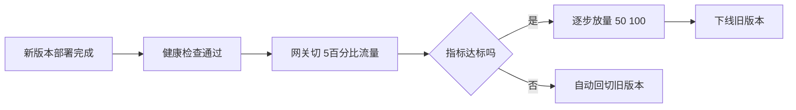

### Q815 · 蓝绿发布与金丝雀灰度

> 难度:★★★★ | 标签:发布, 灰度

**问**:蓝绿和金丝雀的本质区别?灰度的分流键为什么必须稳定?

**答**:蓝绿是**两套完整环境瞬时切换**,回滚秒级但资源双倍,适合大版本;金丝雀是**同一环境内小流量逐步放量**(1% → 5% → 25% → 100%),每档观察错误率与延迟,达标才进下一档,不达标自动回切。分流键必须**稳定**(用户 ID/租户哈希),同一用户始终命中同一版本,否则会话、缓存、灰度逻辑全乱。数据库变更不能靠环境切换解决——它要跨版本兼容,见下一题。



```python
# file: code/03_Web后端开发/q815_canary.py

def route_canary(user_id: str, canary_pct: int) -> str:
    bucket = sum(ord(c) for c in user_id) % 100   # 稳定哈希分桶
    return "canary" if bucket < canary_pct else "stable"

alloc = {"canary": 0, "stable": 0}
for i in range(1000):
    alloc[route_canary(f"user{i}", 10)] += 1
print("灰度分流分布:", alloc)
print("同一用户稳定:", route_canary("user42", 10) == route_canary("user42", 10))
```

**追问**:
- 灰度期间怎么算"达标"?——预先定义指标与阈值(错误率、p99、核心业务转化),样本足够才决策,避免小样本抖动误杀。
- 有状态连接(WebSocket)怎么灰度?——新连接走灰度,存量连接保持旧版本直到自然断开,配合连接迁移协议。
