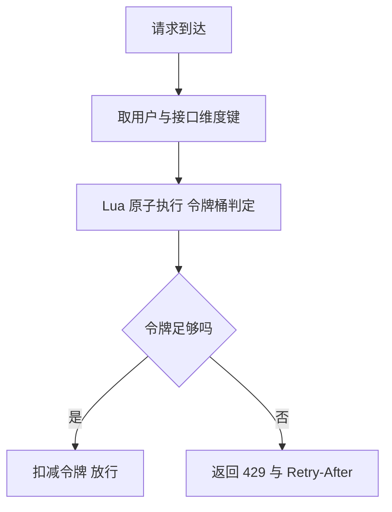

### Q825 · 基于 Redis 的分布式令牌桶限流

> 难度:★★★★ | 标签:限流, Redis

**问**:单机内存限流多 worker 就失效了,分布式限流怎么做?

**答**:把令牌桶状态放 **Redis**,用 Lua 脚本保证"计算余量 + 扣减"的原子性:tokens = min(capacity, tokens + elapsed × rate),够就扣并返回允许,不够返回拒绝。维度按 需求组合:用户、API key、接口、租户。要点:Redis 挂了的策略(降级放行还是拒绝,建议放行+告警)、时钟偏差用 Redis 的 TIME、热 key 用本地预扣减。分层限流:网关粗粒度 → 应用细粒度,互为补充。



```python
# file: code/03_Web后端开发/q825_token_bucket.py
import time

class TokenBucket:
    def __init__(self, capacity: int, refill_per_sec: float):
        self.capacity = capacity
        self.rate = refill_per_sec
        self.tokens = float(capacity)
        self.last = time.monotonic()

    def allow(self, n: int = 1) -> bool:
        now = time.monotonic()
        self.tokens = min(self.capacity, self.tokens + (now - self.last) * self.rate)
        self.last = now
        if self.tokens >= n:
            self.tokens -= n
            return True
        return False

bucket = TokenBucket(capacity=5, refill_per_sec=2)
print("连发 8 个:", [bucket.allow() for _ in range(8)])
time.sleep(0.6)                                # 补充约 1.2 个令牌
print("等待后两连发:", [bucket.allow() for _ in range(2)])
```

**追问**:
- Lua 里为什么要用 Redis 服务端时间?——多客户端时钟不一致会让补币计算漂移,服务端时间保证所有节点看到同一时钟。
- 限流键的粒度怎么定?——限流的目的是保护自身与公平,按"最细的有身份维度+接口"组合,过粗会误伤,过细失去保护意义。
