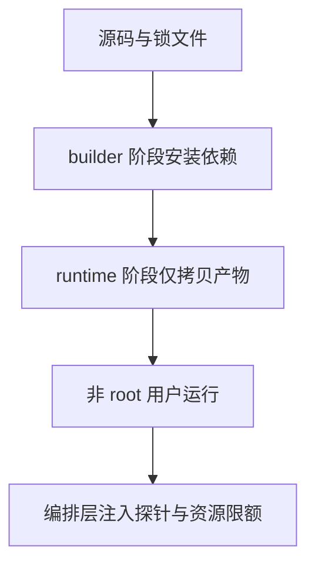

### Q833 · 容器化要点:镜像与 PID 1

> 难度:★★★☆ | 标签:Docker, 容器

**问**:把 Python 服务打进镜像,有哪些直接影响稳定性的细节?

**答**:四件事:CMD 用 **exec 形式**(`CMD ["gunicorn", ...]`),让应用进程成为 PID 1 正确接收 SIGTERM——shell 形式会让 SIGTERM 落在 sh 上,优雅停机失效;**多阶段构建**,builder 装依赖、runtime 只拷产物,镜像小、攻击面小;**非 root 用户**运行;依赖用**锁文件**保证可复现。另有:镜像 tag 不可变(不用 latest 部署)、健康检查交给编排探针、时区与 locale 显式设置。ENTRYPOINT + CMD 组合传参要理解 exec 语义,否则信号全断。



```python
# file: code/03_Web后端开发/q833_dockerfile_notes.py

DOCKERFILE = """
FROM python:3.12-slim AS builder
WORKDIR /app
COPY requirements.txt .
RUN pip install --prefix=/install -r requirements.txt

FROM python:3.12-slim
RUN useradd -m appuser
WORKDIR /app
COPY --from=builder /install /usr/local
COPY . .
USER appuser
CMD ["gunicorn", "-b", "0.0.0.0:8000", "app:app"]
"""
print(DOCKERFILE)
print("要点: exec 形式 CMD 让进程直接收到 SIGTERM")
```

**追问**:
- 为什么 PID 1 收不到 SIGTERM?——shell 形式下 PID 1 是 sh,它不转发信号给子进程;exec 形式应用自己当 PID 1,必须自己处理信号(Gunicorn 内置)。
- 镜像里要不要装 curl 做健康检查?——优先用编排原生探针(httpGet),避免为探针装工具扩大镜像。
