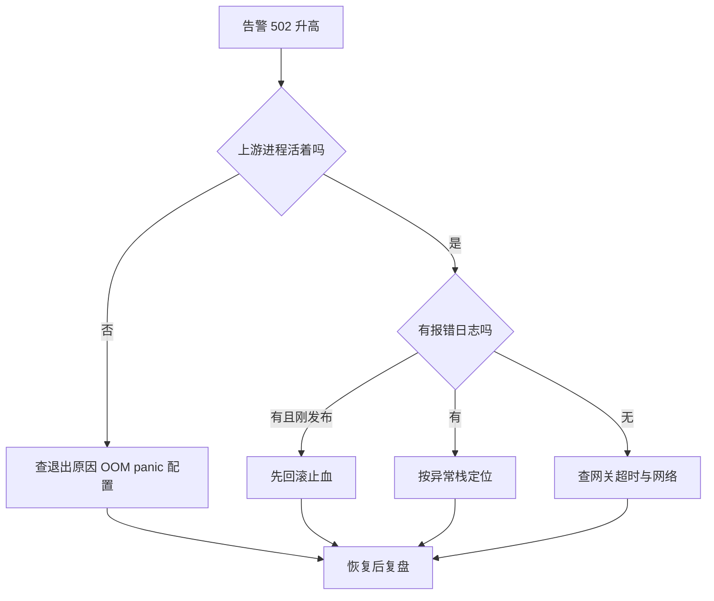

### Q837 · 502 事故复盘方法论

> 难度:★★★★ | 标签:事故复盘, 502

**问**:凌晨告警 502 飙升,你的排查顺序是什么?复盘要产出什么?

**答**:**止血优先**:502=网关拿到无效响应(上游断连),先看上游进程是否存活——死了看退出原因(OOM/panic/配置错),刚发布先回滚;活着则查应用日志异常与网关错误日志(`upstream prematurely closed`)。定位后恢复,再复盘五问:什么变更触发、为何测试没拦住、为何告警滞后、为何恢复慢、**加什么机制防复发**(守护、探针、回滚自动化)。复盘产出:时间线、根因、影响面、带 owner 和 deadline 的行动项。



```python
# file: code/03_Web后端开发/q837_502_triage.py

def triage(upstream_alive: bool, app_log_error: bool, recently_deployed: bool) -> str:
    if not upstream_alive:
        return "进程死了: 查退出原因 OOM panic 配置错误"
    if app_log_error and recently_deployed:
        return "疑似新版本缺陷: 先回滚止血再定位"
    if app_log_error:
        return "应用报错: 按异常日志定位"
    return "检查网关到应用的网络与超时配置"

print(triage(False, False, False))
print(triage(True, True, True))
print(triage(True, False, False))
```

**追问**:
- 502 和 504 怎么快速区分责任?——502 上游主动断/崩,查应用;504 等超时,查慢在哪一层,两者日志特征不同。
- 复盘的行动项怎么避免烂尾?——进缺陷跟踪系统带 owner 与截止时间,下次同类告警的 runbook 同步更新。
