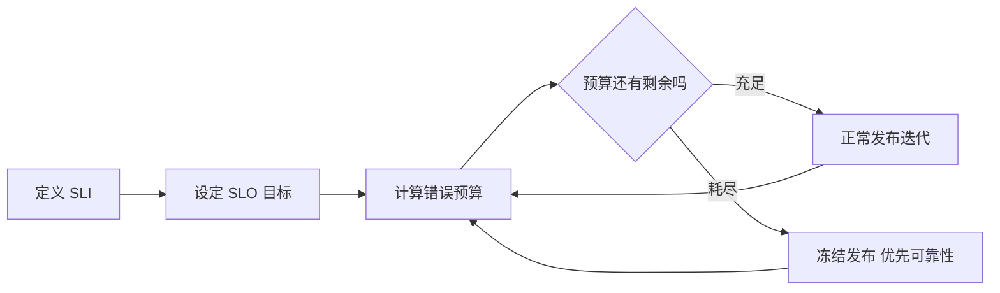

### Q844 · SLA/SLO/SLI 与错误预算

> 难度:★★★★ | 标签:SLO, 可靠性

**问**:这三个概念分别是什么?错误预算怎么驱动可靠性决策?

**答**:**SLI** 是测量指标(成功率、p99 延迟),**SLO** 是内部目标(99.9% 成功率),**SLA** 是对外承诺(违约赔偿)。**错误预算 = 1 − SLO**,即可失败的额度:预算充足时放心发布迭代;预算烧完冻结功能发布、优先修可靠性。这套机制的价值是把"稳定 vs 迭代"的争论变成**数据决策**:产品与工程共同定 SLO(定在用户可感知层面,如"请求成功且 p99 < 800ms"),而不是各自拍脑袋。



```python
# file: code/03_Web后端开发/q844_error_budget.py

def remaining_budget(budget_minutes: float, used_minutes: float) -> float:
    return 1 - used_minutes / budget_minutes

month_min = 30 * 24 * 60
slo = 0.999
budget_min = month_min * (1 - slo)
print("月错误预算分钟:", round(budget_min, 1))
left = remaining_budget(budget_min, 10)
print("已用 10 分钟后剩余比例:", round(left, 3))
print("决策:", "冻结发布" if left <= 0 else "可继续发布")
```

**追问**:
- SLO 定 100% 行不行?——不行,预算为零等于禁止一切迭代,团队会开始隐藏故障,SLO 要定在"用户几乎无感"的水平。
- 多窗口告警是什么?——结合 1h/6h 的烧钱率(预算消耗速率)同时超阈值才告警,比单阈值更准且更少误报。
