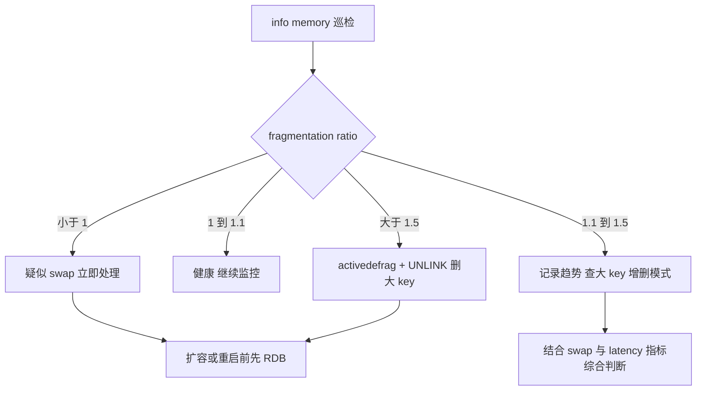

### Q1000 · 内存碎片: mem_fragmentation_ratio 怎么读

> 难度:★★★☆ | 标签:内存, 运维

**问**:info memory 里 mem_fragmentation_ratio 是什么?1.5 说明什么?怎么治理?

**答**:ratio = used_memory_rss(操作系统视角的物理内存)/ used_memory(Redis 逻辑用量)。约 1~1.5 健康;>1.5 说明碎片严重——频繁增删大 value、大量过期键释放后分配器未归还 OS,物理内存虚高;<1(如 0.8)更危险,说明 swap 已发生,内存被换到磁盘,性能断崖。治理:4.0+ 开启 activedefrag(active-defrag-enabled yes,利用空闲 CPU 在线整理);删大 key 用 UNLINK 分批;避免大量同尺寸对象反复增删的模式;设置 maxmemory 留余量;swap 已发生时扩容或重启(重启前 RDB)。监控上把 ratio 与 swap 告警一起配,单看 ratio 会误判。

```python
# file: code/04_数据库与缓存/q1000_fragmentation.py
"""碎片率计算与 activedefrag 决策模拟"""

def frag_ratio(rss_bytes, used_bytes):
    return rss_bytes / used_bytes

def advise(ratio, swapped=False):
    if swapped or ratio < 1.0:
        return "严重: 疑似 swap, 立即扩容/重启, 检查 maxmemory 与宿主内存"
    if ratio <= 1.1:
        return "健康"
    if ratio <= 1.5:
        return "观察: 记录趋势, 检查是否有大 key 反复增删"
    return "治理: 开启 activedefrag, UNLINK 删大 key, 评估扩容"

if __name__ == "__main__":
    cases = [(1.2e9, 1.0e9), (1.6e9, 1.0e9), (0.8e9, 1.0e9)]
    for rss, used in cases:
        r = frag_ratio(rss, used)
        print(f"rss={rss / 1e9:.1f}GB used={used / 1e9:.1f}GB "
              f"ratio={r:.2f} -> {advise(r)}")
    print("注意: used_memory_peak 高峰回落期 ratio 偏高属正常, 看趋势不看单点")
```

**追问**:
- activedefrag 有代价吗?——占用 CPU(可配置 cycle-min/max 百分比),整理期间延迟抖动,低峰开启并观察 latency;
- 为什么 jemalloc 才支持?——activedefrag 依赖 jemalloc 的分配器统计与迁移接口,libc/其他分配器下配置无效。

---


