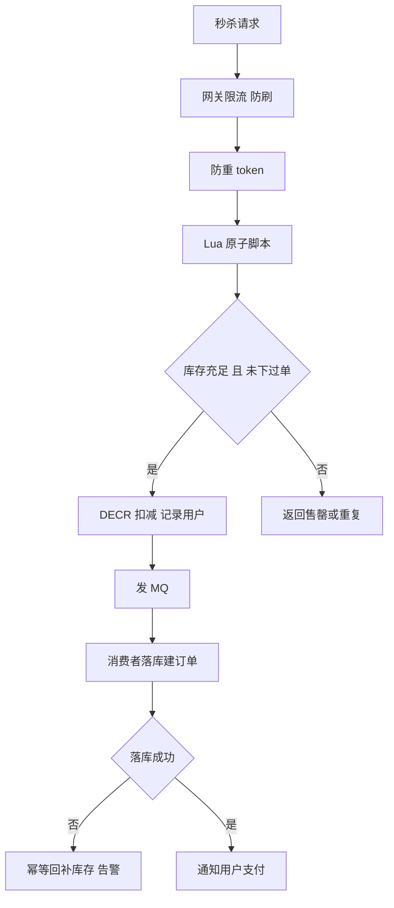

### Q1005 · 秒杀库存: Redis 原子扣减 + 异步落库

> 难度:★★★★★ | 标签:秒杀, Lua

**问**:秒杀链路里 Redis 扮演什么角色?扣减脚本怎么写?后面怎么落库?

**答**:标准链路:预热库存到 Redis -> 请求先过限流与防重 -> Lua 原子"查库存+判断资格+扣减+记录用户"(一人生成一单,SETNX 防重) -> 扣减成功发 MQ -> 消费者落库创建订单(以 MQ 消费结果为准),失败回补库存。要点:一、Lua 里完成全部判断,绝不在应用层"GET 再 DECR";二、扣减与去重键在一个脚本(原子);三、库存预热与热点隔离(单品独立 key);四、落库失败回补要幂等(标记单号);五、超卖兜底——DB 侧 stock>0 条件更新仍是最后防线。量级判断:单品 10 万 QPS 以上考虑分片库存(按 hash 分 N 份扣,总和为真),或直接上专业限流+排队。

```python
# file: code/04_数据库与缓存/q1005_seckill.py
"""秒杀: Lua 原子扣减 + 一人一单 + MQ 异步落库(模拟)"""
import queue
import threading

SECKILL_LUA = """
local stock = tonumber(redis.call('GET', KEYS[1]) or '0')
if redis.call('SETNX', KEYS[2], ARGV[1]) == 0 then
  return -2                                    -- 一人一单: 重复
end
if stock <= 0 then
  redis.call('DEL', KEYS[2])                   -- 回收资格
  return -1                                    -- 售罄
end
redis.call('DECR', KEYS[1])
return 1
"""

class FakeRedis:
    def __init__(self, stock):
        self.kv = {"stock": stock}
        self.lock = threading.Lock()

    def eval(self, script, keys, args):
        with self.lock:
            key_stock, key_user = keys
            if key_user in self.kv:              # SETNX 已存在: 重复下单
                return -2
            stock = int(self.kv.get(key_stock, 0))
            if stock <= 0:
                return -1                        # 售罄
            self.kv[key_user] = "1"              # 记录资格
            self.kv[key_stock] = stock - 1
            return 1

if __name__ == "__main__":
    r = FakeRedis(stock=3)
    mq = queue.Queue()
    def buyer(uid):
        rc = r.eval(SECKILL_LUA, ["stock", f"u:{uid}:order"], [uid])
        if rc == 1:
            mq.put(uid)                          # 成功才入队落库
        return rc
    codes = {}
    uids = [0, 1, 2, 3, 4, 0]                    # 最后一个是重复用户
    ts = [threading.Thread(target=lambda i=i: codes.__setitem__(i, buyer(uids[i])))
          for i in range(len(uids))]
    [t.start() for t in ts]
    [t.join() for t in ts]
    print("扣减结果:", codes, "<- 3 个 1 成功, 1 个 -1 售罄, 1 个 -2 重复")
    print("MQ 待落库:", list(mq.queue), "-> 消费者建订单, 失败幂等回补")
```

**追问**:
- 库存分片怎么实现?——stock 拆成 stock:0..N-1,请求随机挑桶扣,单桶售罄换桶;N 份总和与 DB 对账,分片牺牲部分公平换吞吐。
- 用户付不了款订单回滚,库存怎么回补?——订单超时取消事件触发 Lua INCR 回补(校验单号防重复回补),回补后可再次售出。

---


