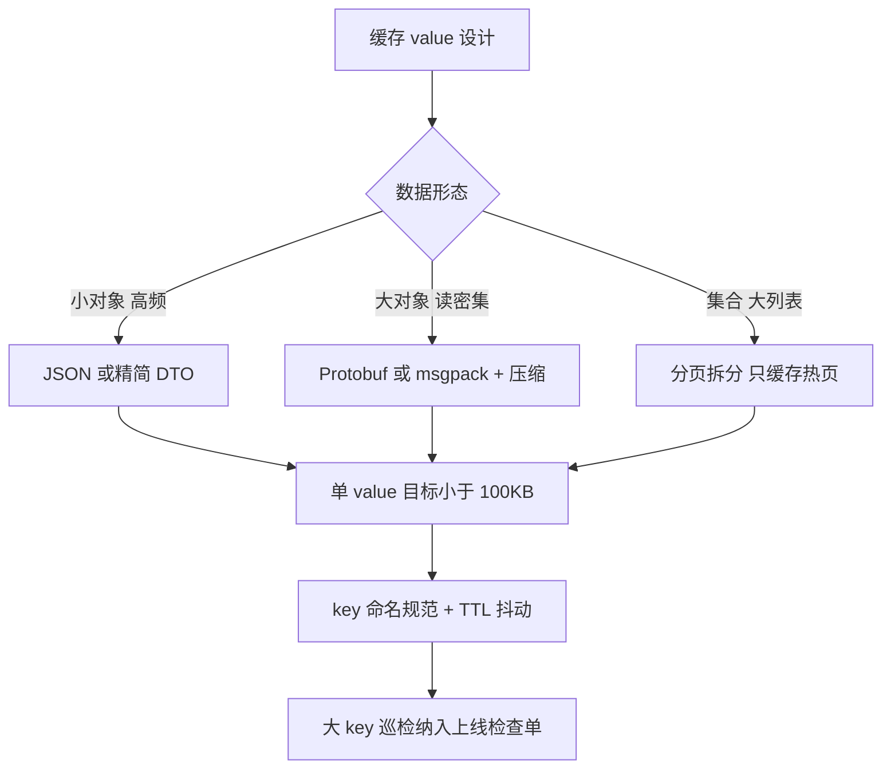

### Q1010 · 序列化与 value 大小控制

> 难度:★★★☆ | 标签:序列化, 性能

**问**:缓存 value 用 JSON 还是二进制?value 多大算大?怎么控制?

**答**:选型:JSON 可读、跨语言、调试方便,体积大;MessagePack/Protobuf 紧凑 30%~50%、解析快,适合大 value 与高 QPS;内部服务一致即可,别混用。大小红线经验值:单 value 控制在 10KB~100KB,超过 1MB 就是大 value(网络、序列化、内存分配、主从复制全面承压)。控制手段:只存必要字段(DTO 裁剪,别把 ORM 整对象 dump)、列表分页存(只缓存当前页)、大对象拆分(用户资料与订单列表分开)、压缩(gzip/zstd,cpu 换带宽,压缩后仍大就拆)。序列化注意版本兼容(字段演进别破坏旧缓存)与不可序列化对象(set/datetime 的显式转换)。

```python
# file: code/04_数据库与缓存/q1010_serialization.py
"""JSON vs 精简 DTO 的 value 大小对比"""
import json

def big_dto(user):
    return {**user, "orders": [f"order{i}" for i in range(200)],
            "logs": [f"log{i}" for i in range(100)]}

def slim_dto(user):
    return {"id": user["id"], "name": user["name"]}

if __name__ == "__main__":
    user = {"id": 1, "name": "alice", "phone": "138...", "_internal": "xx"}
    b = json.dumps(big_dto(user)).encode()
    s = json.dumps(slim_dto(user)).encode()
    print(f"全量 dump: {len(b)} bytes")
    print(f"精简 DTO: {len(s)} bytes, 节省 {1 - len(s) / len(b):.0%}")
    print("规范: value < 100KB 优先; 1MB+ 拆分; 二进制协议可再省 30~50%")
```

**追问**:
- 缓存对象的字段演进怎么兼容?——value 里带 schema 版本,读取端按版本映射;或字段只增不删+默认值,旧缓存自然兼容到 TTL 过期。
- 什么时候该压缩?——value 大(>50KB)且读多写少时收益明显;高频小 value 压缩的 CPU 成本大于网络收益,不划算。

---


