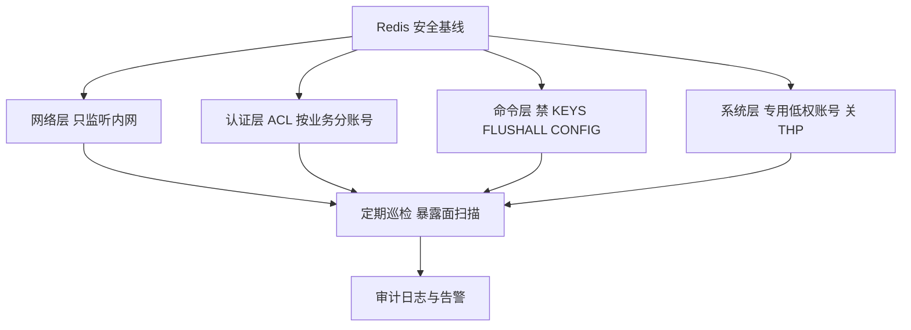

### Q1015 · Redis 安全: ACL 与暴露面收敛

> 难度:★★★☆ | 标签:安全, ACL

**问**:Redis 被入侵的常见原因是什么?6.0 的 ACL 怎么用?生产安全清单有哪些?

**答**:常见事故:裸奔公网 + 默认无密码/弱密码 -> CONFIG SET dir 写入 crontab/webshell 拿服务器。生产清单:一、网络层——只监听内网、bind 指定 IP、防火墙/安全组,严禁 0.0.0.0 + 公网;二、认证——requirepass 或 6.0 ACL(用户/密码/命令/键四维授权:`user app_user on >pwd ~app:* +@read +@write -@dangerous`),按业务分账号,运维账号禁 FLUSHALL/CONFIG;三、命令收敛——rename-command/ACL 禁用 KEYS、FLUSHALL、CONFIG、DEBUG;四、防利用——禁用危险 dir/DBFILENAME 配置变更(6.0+ CONFIG SET 受 ACL 限制)、普通用户跑 redis 账号;五、TLS(6.0+)与审计日志。ACL 让"一个 Redis 多业务"的隔离成为可能,不再靠 rename-command 打补丁。

```python
# file: code/04_数据库与缓存/q1015_redis_acl.py
"""ACL 规则建模: 用户/命令类别/键前缀 校验器"""
class ACL:
    DANGEROUS = {"keys", "flushall", "flushdb", "config", "debug", "shutdown"}

    def __init__(self):
        self.users = {}

    def create_user(self, name, password, patterns, allow_categories,
                    deny_commands=()):
        self.users[name] = {"password": password, "patterns": patterns,
                            "allow": allow_categories,
                            "deny": set(deny_commands) | self.DANGEROUS}

    def check(self, name, password, cmd, key):
        u = self.users.get(name)
        if not u or u["password"] != password:
            return False, "认证失败"
        if cmd in u["deny"]:
            return False, f"命令 {cmd} 被禁用"
        if not any(key.startswith(p.rstrip("*")) for p in u["patterns"]):
            return False, f"键 {key} 越权"
        return True, "ok"

if __name__ == "__main__":
    acl = ACL()
    acl.create_user("app", "s3cret", ["app:*"], ["read", "write"])
    for user, pwd, cmd, key in [
            ("app", "s3cret", "get", "app:stock:1"),
            ("app", "s3cret", "keys", "*"),
            ("app", "wrong", "get", "app:stock:1"),
            ("app", "s3cret", "get", "other:secret")]:
        ok, msg = acl.check(user, pwd, cmd, key)
        print(f"{cmd:>5} {key:<18} -> {'允许' if ok else '拒绝: ' + msg}")
```

**追问**:
- rename-command 与 ACL 怎么选?——6.0+ 一律 ACL(结构化、可审计);老版本才用 rename-command 打补丁,升级后迁移。
- 怎么防"写 crontab"类利用?——redis 进程用专用低权账号跑(crontab 不可写)、禁 CONFIG SET 改 dir、服务器上 redis 用户无 shell。

---


