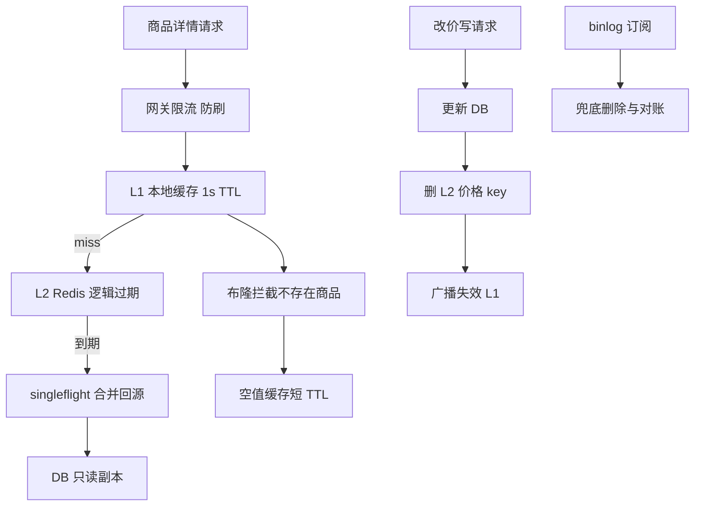

### Q1020 · 综合案例: 高并发商品详情缓存体系

> 难度:★★★★★ | 标签:综合案例, 架构

**问**:商品详情页 QPS 10 万,商品数据多表组成、秒级变价,设计完整缓存体系。

**答**:分层作答:一、读路径——L1 本地缓存(1s TTL,扛热点)→ L2 Redis(商品 JSON,5min TTL + 逻辑过期)→ DB;热点商品用逻辑过期永不物理失效,配合 singleflight 合并回源,防击穿;二、写路径——改价走 Cache Aside:更新 DB → 删 L2 → 广播失效 L1;价格字段单独小 key(变价高频只失效价格),详情大 JSON 低频;三、防护——布隆过滤器拦截不存在商品 id,空值缓存防穿透,限流+熔断保 DB,DB 回源走只读副本;四、一致性——binlog 订阅兜底删除(Q974),对账每日校验缓存与库抽样一致;五、容量——按 Q1014 模型估算分片,L1 只放 Top 商品。回答时先画图再逐层说清"每个缓存问题(穿透/击穿/雪崩/一致)在哪一层由什么机制解决"。

```python
# file: code/04_数据库与缓存/q1020_cache_system.py
"""商品详情缓存体系骨架: 两级缓存 + 逻辑过期 + singleflight + 防穿透"""
import time

class ProductCacheSystem:
    def __init__(self, db, capacity=2):
        self.db = db
        self.l1, self.l2 = {}, {}
        self.logic_expire = {}                   # 逻辑过期时间
        self.null_cache = set()                  # 空值防穿透
        self.bloom = set()                       # 演示用简化布隆
        self.sf_locks = {}

    def warm(self, ids):
        self.bloom.update(ids)

    def get(self, pid):
        if pid not in self.bloom or pid in self.null_cache:
            return None                          # 防穿透: 肯定不存在
        now = time.monotonic()
        if pid in self.l1:
            return self.l1[pid], "L1"
        if pid in self.l2 and self.logic_expire[pid] > now:
            self.l1[pid] = self.l2[pid]          # 未到期直接用
            return self.l2[pid], "L2"
        # 到期: 逻辑过期异步重建(演示为同步 + 合并)
        v = self.db[pid]
        self.l2[pid], self.logic_expire[pid] = v, now + 5
        self.l1[pid] = v
        return v, "DB 回源"

    def update_price(self, pid, price):
        self.db[pid] = {**self.db[pid], "price": price}
        self.l2.pop(pid, None)                   # 删 L2
        self.l1.pop(pid, None)                   # 广播失效 L1(同进程演示)

if __name__ == "__main__":
    db = {1001: {"name": "键盘", "price": 199}}
    sys_ = ProductCacheSystem(db)
    sys_.warm([1001])
    print("首次读:", sys_.get(1001))
    print("二次读:", sys_.get(1001), "<- L1 命中")
    sys_.update_price(1001, 179)
    print("改价后读:", sys_.get(1001), "<- 回源新值")
    print("不存在商品:", sys_.get(9999), "<- 布隆拦截, 不打 DB")
    print("生产还需: binlog 兜底删除 / 熔断限流 / 对账 / 多分片容量规划")
```

**追问**:
- 价格与详情为什么拆两个 key?——变价频率远高于详情,拆开后高频变价只失效小 key,详情缓存命中率不受影响,失效风暴半径也小。
- 逻辑过期怎么配合删除策略?——逻辑过期键"永不过期",更新走"后台重建",避免删除瞬间的击穿;但数据精度依赖重建间隔,对价格这类敏感字段要缩短重建周期或改走独立通道。

---


