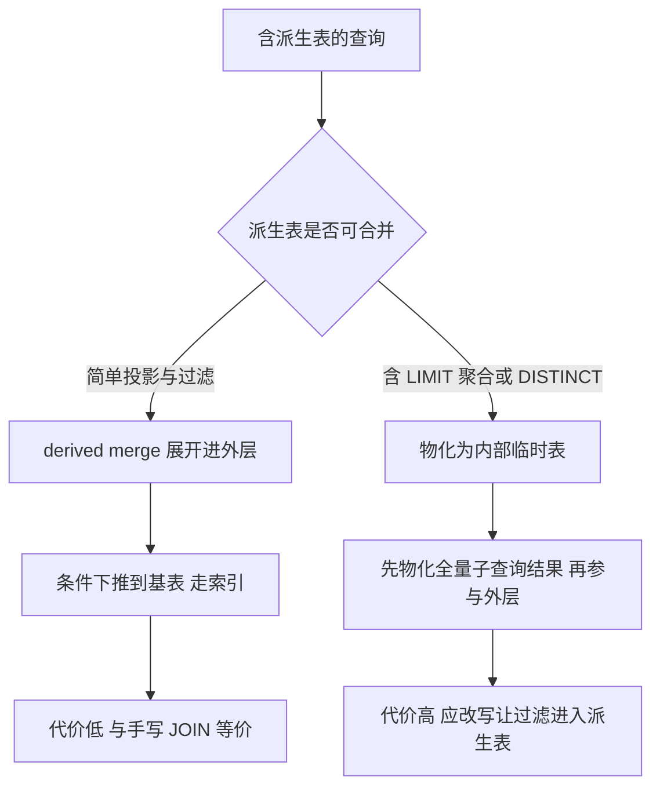

### Q1393 · 派生表优化: derived merge 与物化的分界

> 难度:★★★☆ | 标签:SQL 调优, 执行计划

**问**:FROM 子句里的子查询一定慢吗?优化器怎么处理派生表?

**答**:不一定。MySQL 5.7+ 的 derived_merge 优化能把"简单投影 + 过滤"的派生表直接展开合并进外层查询,条件可以下推到基表、索引照常用,与手写 JOIN 无差别。不能合并的典型:带 LIMIT、聚合、GROUP BY、DISTINCT、窗口函数的派生表——这些必须先物化成内部临时表再参与外层。物化不可怕,可怕的是外层过滤条件进不去:把过滤写到派生表内部,或改写成 JOIN/窗口结构让条件下推。判断依据是 EXPLAIN 里是否出现 DERIVED 物化节点。

```python
# file: code/04_数据库与缓存/q1393_derived_merge.py
"""派生表的合并与物化: 哪些子查询可以被优化器展开"""
import sqlite3

conn = sqlite3.connect(":memory:")
conn.execute("CREATE TABLE orders(id INTEGER PRIMARY KEY, user_id INTEGER, amount REAL)")
conn.executemany("INSERT INTO orders VALUES(?,?,?)",
                 [(i, i % 1000, 9.9) for i in range(20000)])

def plan(sql, label):
    print(label)
    for r in conn.execute("EXPLAIN QUERY PLAN " + sql):
        print("   ", r[3])

plan("SELECT * FROM (SELECT id, user_id, amount FROM orders WHERE amount > 5) t "
     "WHERE t.user_id = 7", "[简单投影] 可合并 条件可下推:")
plan("SELECT * FROM (SELECT id, user_id FROM orders ORDER BY id LIMIT 100) t "
     "WHERE t.user_id = 7", "[带 LIMIT] 不可合并 需物化:")
plan("SELECT * FROM (SELECT user_id, COUNT(*) c FROM orders GROUP BY user_id) t "
     "WHERE t.user_id = 7", "[聚合派生表] 物化后过滤:")
```

**追问**:
- 为什么 LIMIT 会阻断合并?——合并后外层的过滤、连接都可能改变行的取舍顺序,LIMIT 的语义就不成立了,所以优化器保守物化。
- 物化什么时候真正变贵?——外层过滤没下推进派生表时,临时表要装全量子查询结果再逐行筛;把 WHERE 写进派生表内部或确认条件下推,物化体积能差几个量级。
- 物化的临时表底层怎么组织?——MySQL 物化时会按外层关联列给临时表建 auto_key 加速 JOIN,超过 tmp_table_size 或含大字段就落盘,IO 与体积同步放大。
- 常见的工程陷阱?——把分页排序子查询包成派生表再套一层过滤,以为条件会下推其实没下推;上线前用 EXPLAIN 确认 DERIVED 物化节点,别凭直觉。

---


