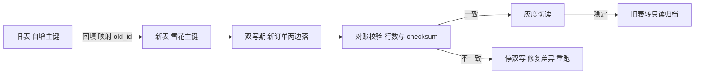

### Q1406 · 主键迁移: 自增换雪花 ID 的在线切换

> 难度:★★★★ | 标签:主键, 数据迁移

**问**:线上表的主键要从自增 int 换成雪花 ID,怎么不停车完成?

**答**:三阶段。回填:建新表,主键直接是 bigint 雪花,加一列 old_id 建 UNIQUE 索引,把旧表数据映射进新表,UNIQUE 保证回填重跑幂等;双写:新业务写两个库,新表主键用新生成的雪花 ID,历史行靠 old_id 关联;切读:读路由灰度切到新表,校验行数、抽样与 checksum,稳定后旧表转只读归档。注意雪花 ID 的时间位决定了它趋势递增,InnoDB 聚簇索引插入顺序友好;切换期间要处理"读旧表拿 id 再操作"的存量调用方,过渡期保留 old_id 映射接口。Q903 讲过自增上限问题,本题是它的落地路径。

```python
# file: code/04_数据库与缓存/q1406_pk_migrate.py
"""主键迁移: 自增换雪花 ID 的在线切换"""
import sqlite3
import time

conn = sqlite3.connect(":memory:")
conn.execute("CREATE TABLE orders_old(id INTEGER PRIMARY KEY AUTOINCREMENT, amount REAL)")
conn.execute(
    "CREATE TABLE orders_new(id INTEGER PRIMARY KEY, old_id INTEGER UNIQUE, amount REAL)")
conn.executemany("INSERT INTO orders_old(amount) VALUES(?)", [(99.0,), (199.0,), (299.0,)])

machine_id = 1
seq = 0
def snowflake():
    global seq
    seq = (seq + 1) & 0xFFF
    return (int(time.time() * 1000) << 22) | (machine_id << 12) | seq

for oid, amt in conn.execute("SELECT id, amount FROM orders_old").fetchall():
    conn.execute("INSERT OR IGNORE INTO orders_new VALUES(?,?,?)", (snowflake(), oid, amt))
new_id = snowflake()                          # 双写期新订单: 两边落, 新主键用雪花
conn.execute("INSERT INTO orders_old(amount) VALUES(?)", (499.0,))
conn.execute("INSERT INTO orders_new VALUES(?,?,NULL)", (new_id, 499.0))
n_old = conn.execute("SELECT COUNT(*) FROM orders_old").fetchone()[0]
n_new = conn.execute("SELECT COUNT(*) FROM orders_new").fetchone()[0]
print(f"旧表 {n_old} 行, 新表 {n_new} 行(3 条迁移 + 1 条双写)")
ids = [r[0] for r in conn.execute("SELECT id FROM orders_new ORDER BY id")]
print("新主键样例:", ids[0], f"({len(str(ids[0]))} 位), 趋势递增且全局唯一")
print("unique(old_id) 让回填重跑幂等, 是切换安全的关键")
```

**追问**:
- 为什么新表还留 old_id 列?——过渡期排查、对账、以及旧调用方按旧 id 查询都要靠它;全量切读稳定后再评估下线。
- 雪花 ID 为什么对聚簇索引友好?——高位是毫秒时间戳,趋势递增让插入总落在 B+ 树最右侧,页分裂少;对比随机 UUID 的页分裂与缓冲池污染。
- 双写期两套主键怎么衔接?——新订单由应用生成雪花 ID 两边落,历史行靠 old_id 唯一索引映射;键空间靠映射列衔接,不做数字换算。
- 生产陷阱?——切读后仍有调用方拿旧 id 调接口,404 事故;过渡期保留按 old_id 查询的兼容接口并打监控,流量归零后才评估下线。

---


