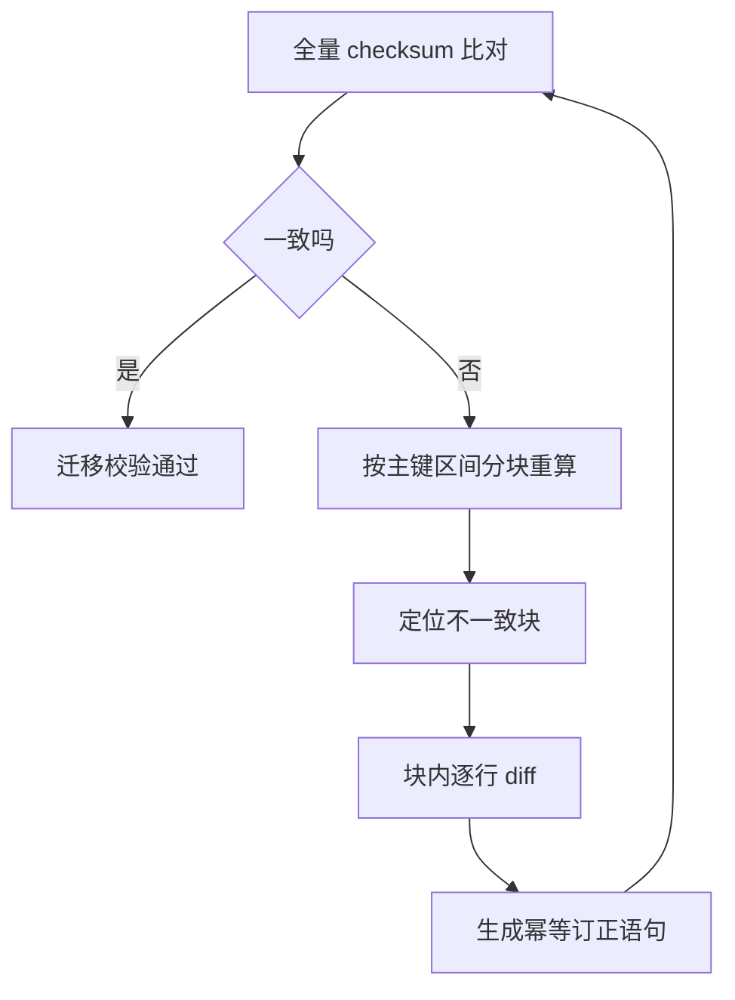

### Q1409 · 迁移的数据校验: 行数、抽样与分块 checksum

> 难度:★★★☆ | 标签:数据迁移, 校验

**问**:迁移完了,你怎么向老板证明"数据没丢没坏"?

**答**:三档校验递进:行数对账最快,按表/按天分桶统计两侧 count,适合第一道筛;抽样比对按主键随机抽几百行逐字段比对,能发现字段级漂移但覆盖有限;全量 checksum 最硬——对每行按主键序拼接字段值算哈希,再对整个表(或按主键区间分块)聚合成一个校验值,两侧对比,不一致就二分下钻到块、再到行。pt-table-checksum 就是这个思路的成熟工具,分块计算还能边跑边对边避开大事务。校验脚本必须幂等、可重入,输出差异明细而不只是布尔值,因为修复(Q1403)需要精确到行。

```python
# file: code/04_数据库与缓存/q1409_row_checksum.py
"""迁移数据校验: 行数、抽样与分块 checksum 对比"""
import hashlib
import json
import random

random.seed(8)
old = {i: {"uid": i % 100, "amount": round(random.uniform(1, 100), 2)}
       for i in range(1, 501)}
new = {i: dict(v) for i, v in old.items()}
new[250]["amount"] += 0.01                    # 模拟一处漂移

def block_checksum(rows):
    h = hashlib.md5()
    for k in sorted(rows):
        h.update(("%d:%s" % (k, json.dumps(rows[k], sort_keys=True))).encode())
    return h.hexdigest()

print("行数一致:", len(old) == len(new))
print("全量 checksum 一致:", block_checksum(old) == block_checksum(new))
if block_checksum(old) != block_checksum(new):
    for lo in range(1, 501, 100):
        b1 = block_checksum({k: v for k, v in old.items() if lo <= k < lo + 100})
        b2 = block_checksum({k: v for k, v in new.items() if lo <= k < lo + 100})
        if b1 != b2:
            bad = [k for k in range(lo, lo + 100) if old[k] != new.get(k)]
            print(f"  分块定位: [{lo},{lo + 100}) 不一致, 具体行 {bad}")
```

**追问**:
- 为什么先按主键排序再算哈希?——哈希聚合必须与行序无关才能两侧可比,按主键序是两侧天然一致的遍历顺序,也是分块下钻的坐标。
- 浮点字段为什么容易 checksum 误报?——两侧类型与精度差异(REAL 对 DECIMAL)让同一业务值哈希不同;校验前按列类型归一化,金额统一到分再参与哈希。
- 分块 checksum 怎么支持在线校验?——按主键区间分块独立计算比对,块间穿插休眠避开大事务;不一致块再二分下钻,最终定位到行再交修复(Q1403)。
- 生产陷阱?——迁移一完成就全量 checksum,与仍在追平的增量撞车,产出海量假差异;校验放在增量归零的静止点,或按位点切割校验区间。

---


