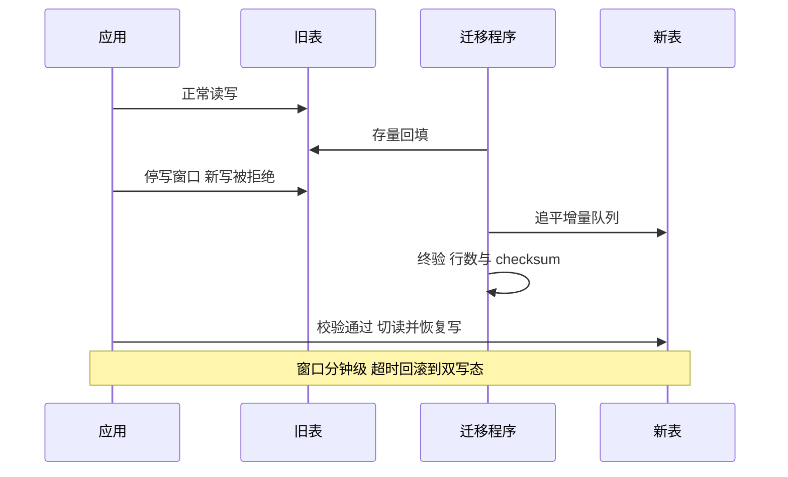

### Q1411 · 停写窗口与最终切换: cutover 的分钟级剧本

> 难度:★★★★ | 标签:数据迁移, cutover

**问**:双写、回填、校验都做完后,最后一刀怎么切?停写窗口里具体发生什么?

**答**:标准剧本五步,全程分钟级:一、预告与预案——冻结相关发布,值班就位,回滚开关预热;二、停写——网关层拒绝新写并返回友好错误(或排队重试),此时源库完全静止,是天然的校验基准点;三、追平增量——把停写前最后一刻的待同步队列消费完,增量差异归零;四、终验——行数/checksum/抽样三件套在静止数据上跑,几分钟内出结果;五、切读切写——读路由指向新库,写开关放开,观察核心指标。窗口超时(比如 15 分钟)则整体回滚到双写态,绝不边切边修。Q953 给了影子表的整体路径,本题聚焦最后这一刀的执行纪律:静止点校验是它区别于"边写边切"的全部价值。

```python
# file: code/04_数据库与缓存/q1411_cutover.py
"""停写切换 cutover: 锁写 -> 追平增量 -> 校验 -> 切读"""
import queue

src, dst = {}, {}                     # 模拟旧表/新表
pending = queue.Queue()               # 迁移期增量队列
state = {"writes": True, "read_from": "src"}

def business_write(uid, name):
    if not state["writes"]:
        raise RuntimeError("cutover 停写窗口: 请稍后重试")
    src[uid] = name
    pending.put(uid)

for i in range(1, 6):
    business_write(i, "u%d" % i)

state["writes"] = False               # 步骤 1: 停写
for uid in list(src):                 # 步骤 2: 存量已对齐
    dst[uid] = src[uid]
while not pending.empty():            # 追平停写前的增量队列
    uid = pending.get()
    dst[uid] = src[uid]
ok = dst == src                       # 步骤 3: 终验
if ok:
    state["read_from"] = "dst"        # 步骤 4: 切读
    state["writes"] = True            # 步骤 5: 恢复写
print("终验一致:", ok, "新表行数:", len(dst), "读路由:", state["read_from"], "可写:", state["writes"])
print("窗口分钟级; 超时回滚: 读路由拨回 src, 保持双写, 另约窗口")
```

**追问**:
- 不停写能不能完成切换?——可以,那就是纯双写+灰度切读路线,不需要窗口,但校验永远面对"移动靶",对账成本与风险窗口更长;停写是用几分钟换确定性。
- 停写期间的写请求怎么安置?——网关快速失败并带 Retry-After,或前置队列暂存窗口期写、切完重放;原则是客户端语义明确,绝不静默丢写。
- 为什么必须在静止点终验?——数据静止后行数与 checksum 是确定值,几分钟能复算;移动靶上的校验只能抽样,证据强度差一个量级。
- 生产陷阱?——冻结了发布却漏了定时任务与 MQ 消费者仍在写,静止点根本不静;停写清单要列全所有写入方,并核实写入计数归零再开验。

---


