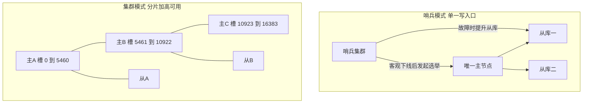

### Q1416 · 哨兵与集群怎么选: 两种高可用模型的分界

> 难度:★★☆☆ | 标签:Redis, 架构

**问**:哨兵模式和 Cluster 模式各自解决什么问题?什么情况下必须上 Cluster?

**答**:哨兵解决"高可用"不解决"容量":主从复制 + 故障转移,仍是单主写入,写吞吐与内存上限都是一台机器,适合数据量单机可扛(几十 GB 内)但要求自动容灾的场景。Cluster 同时解决"分片 + 高可用":16384 个槽分摊到多主,每个主再挂从,写容量水平扩展,但代价是多 key 命令、事务、Lua 受槽约束(只能同槽或 hash tag),客户端要支持 MOVED/ASK 重定向,运维复杂度上升。选择路径:先估算内存与写入 QPS——单机能扛就哨兵;内存超单机、写入打满网卡、或大 key 拆分后仍不够,才上 Cluster。别为了"看起来高级"直接 Cluster,槽约束会让不少 Lua 与 pipeline 代码重写。

```python
# file: code/04_数据库与缓存/q1416_sentinel_vs_cluster.py
"""哨兵 vs 集群: 两种高可用模型的职责差异"""
import zlib

def slot(key):
    return zlib.crc32(key.encode()) % 16384   # 真实 Redis 用 CRC16, 此处示意

for k in ("user:1", "user:2", "order:100", "user:1:profile"):
    print(k, "-> 槽", slot(k))
print("hash tag user:{1}:x 可强制同槽, 支撑多 key 命令")
print("哨兵: 不分片, 容量上限 = 单机, 提供故障转移")
print("集群: 分片 + 高可用, 写入水平扩展, 但多 key 命令受槽约束")
```

**追问**:
- Cluster 下 Lua 脚本为什么常报错?——脚本访问的 key 不在同一槽,只能用 hash tag 把相关 key 规划到同一槽,或在应用侧拆分调用。
- hash tag 怎么起作用?——key 中第一个 {...} 内的内容参与槽计算,{} 外忽略;user:{100}:a 与 user:{100}:b 必同槽,代价是相关 key 挤在同一分片,热点要权衡。
- MOVED 与 ASK 差在哪?——MOVED 表示槽已永久归属新节点,客户端应更新槽表;ASK 是迁移中的临时态,只对本次请求生效,不更新本地槽表。
- 生产陷阱?——上 Cluster 后才发现多 key 命令、事务、Lua 全受槽约束要重写;迁移前审计多 key 用法,该 hash tag 的提前规划。

---


