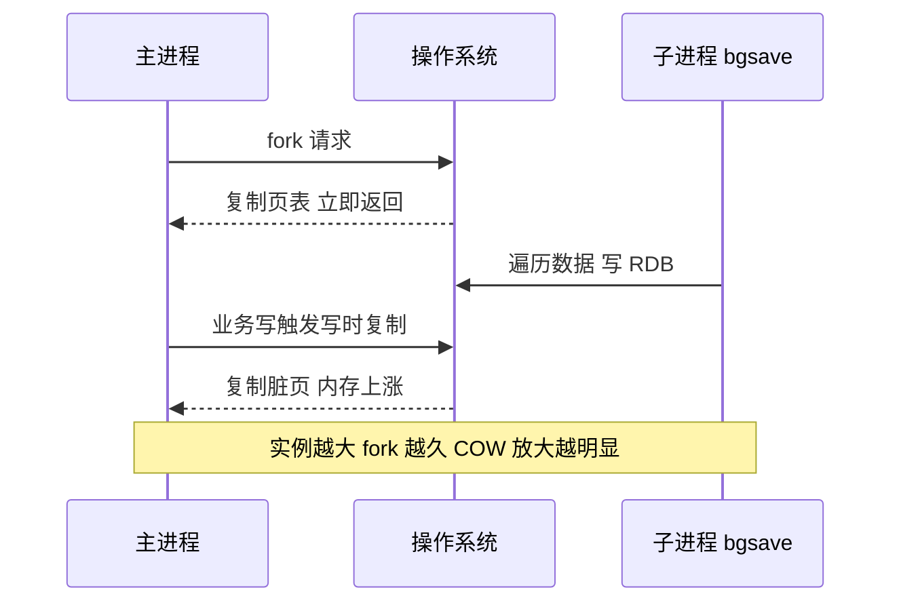

### Q1421 · 持久化阻塞: fork 时延与 COW 的连锁反应

> 难度:★★★☆ | 标签:Redis, 持久化

**问**:bgsave 不是后台线程做的吗,为什么还会阻塞主线程?

**答**:阻塞点在 fork:Linux 的 fork 要复制父进程页表并标记写时复制,实例内存越大页表越大,fork 耗时越长——INFO 里的 latest_fork_usec 就是这个值,大实例可达几百毫秒,这段时间主线程完全停摆,所有命令排队。fork 之后子进程遍历数据写 RDB;期间主进程的每次写都会触发 COW 复制对应内存页,内存占用最高可能接近翻倍,内存不足就会 swap,延迟雪崩;AOF rewrite 同理。缓解:实例内存别无限膨胀(拆分比调参有效);RDB/AOF rewrite 错峰到低峰期;监控 latest_fork_usec 与 swap;关闭透明大页 THP——4MB 大页会让 COW 的复制粒度放大几百倍。Q167 讲持久化原理,本题聚焦"它什么时候会疼"。

```python
# file: code/04_数据库与缓存/q1421_persistence_block.py
"""持久化阻塞: fork 时延随实例内存增长与 COW 写惩罚"""
def fork_cost_ms(mem_gb):
    return mem_gb * 50                  # 页表建立与遍历的粗略模型

def cow_penalty_ms(mem_gb, dirty_ratio):
    return dirty_ratio * mem_gb * 300   # rewrite 期间业务写触发写时复制的粗略模型

print("实例内存 -> fork 预估毫秒(bgsave / AOF rewrite 前置):")
for g in (1, 4, 10, 30):
    print(f"  {g:>2} GB: {fork_cost_ms(g):5.0f} ms")
for ratio in (0.05, 0.2):
    print(f"rewrite 期脏页比例 {ratio:.0%}: COW 惩罚约 {cow_penalty_ms(10, ratio):.0f} ms")
print("对策: 限制单实例内存, 持久化错峰, 关 THP, 盯 latest_fork_usec")
```

**追问**:
- AOF everysec 最多丢多少数据?——正常情况最多 1 秒;但若磁盘写入阻塞导致 fsync 积压,主线程写会等待,这时延迟比丢数据更早被感知。
- latest_fork_usec 怎么读?——INFO 里的最近一次 fork 耗时微秒数,大实例到几百毫秒就是故障级;把毛刺时刻与 bgsave/AOF rewrite 触发时间对齐即可定罪。
- THP 为什么把 COW 放大几百倍?——写时复制按页粒度复制,4KB 页变 2MB 大页后改一个字节也要复制 2MB;fork 后写越密内存涨越快,官方要求 never。
- 生产陷阱?——单实例内存无上限,fork 时长与 COW 双双失控;拆小实例比调参有效,持久化错峰,盯 latest_fork_usec 与 RSS 突增。

---


